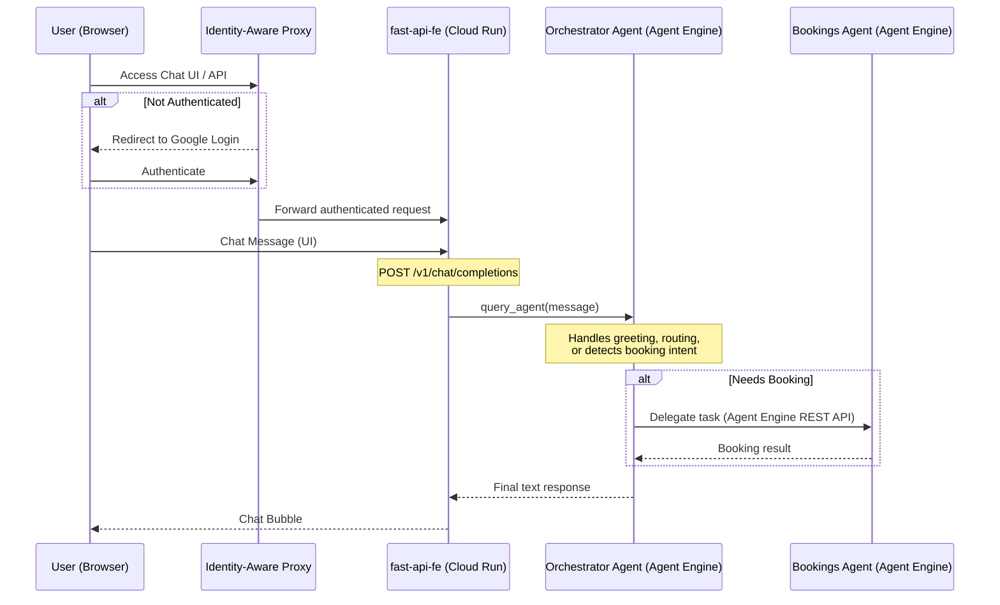

# fast-api-fe — Orchestrator Chatbot

A FastAPI web application that serves:

- **Chat UI** — modern dark-mode single-page UI at `GET /`
- **OpenAI-compatible API** — `POST /v1/chat/completions` that proxies to the `orchestrator` ADK agent via the **Vertex AI Agent Engine REST API**

> **Communication & Discovery layers:**
>
> - `fast-api-fe` → Agent Registry: Discovers Orchestrator Reasoning Engine dynamically (`google.adk.integrations.agent_registry.AgentRegistry`)
> - `fast-api-fe` → `orchestrator` agent: Vertex AI Agent Engine REST API (session + streaming query)
> - `orchestrator` agent → `bookings` agent: A2A [experimental]

## Architecture



## Project Structure

```
fast-api-fe/
├── main.py                 # FastAPI app entry point
├── routers/
│   ├── chat.py             # POST /v1/chat/completions
│   └── ui.py               # GET / (renders chat.html)
├── services/
│   └── agent_client.py     # Vertex AI Agent Engine proxy
├── models/
│   └── openai_schema.py    # Pydantic OpenAI schema models
├── templates/
│   └── chat.html           # Jinja2 chat UI
├── static/
│   ├── style.css           # Dark glassmorphism styles
│   └── chat.js             # Fetch-based chat client
├── pyproject.toml
├── Dockerfile
└── .dockerignore
```

## Prerequisites

- Python 3.12+
- A deployed `orchestrator` agent on Vertex AI Agent Engine
- GCP credentials with `roles/aiplatform.user`

## Local Development

```bash
# 1. Install dependencies
cd fast-api-fe
uv sync  # or uv pip install .

# 2. Set environment variables
export PROJECT_ID=agent-security-patterns
export LOCATION=us-central1
export ORCHESTRATOR_AGENT_DISPLAY_NAME="Orchestrator Agent"
# Optional static override (if not set, resolved dynamically via Agent Registry):
# export ORCHESTRATOR_ENGINE_ID="projects/48196429354/locations/us-central1/reasoningEngines/1818476233864773632"
export IAP_EXPECTED_AUDIENCE="/projects/48196429354/global/backendServices/4183350616699027175"

# 3. Run the server (from project root)
uvicorn fast-api-fe.main:app --reload --port 8080

# 4. Open http://localhost:8080
```

## API Usage

```bash
curl -X POST http://localhost:8080/v1/chat/completions \
  -H "Content-Type: application/json" \
  -d '{"messages": [{"role": "user", "content": "Hello"}]}'
```

## Docker & Cloud Run

### 1. Build and Push via Cloud Build

Run this from the **project root** to build the image and push it to Artifact Registry:

```bash
# Substitutions are used for the image tag
gcloud builds submit --config .cloudbuild/build-fast-api-fe.yaml \
  --substitutions=COMMIT_SHA=$(git rev-parse HEAD) .
```

### 2. Deploy to Cloud Run

Deploy the `latest` image to Cloud Run with the required environment variables:

```bash
PROJECT_ID="$(gcloud config get-value project)"
REGION=us-central1
IMAGE="${REGION}-docker.pkg.dev/${PROJECT_ID}/agent-repo/fast-api-fe:latest"
ORCHESTRATOR_ENGINE_ID="projects/48196429354/locations/us-central1/reasoningEngines/1818476233864773632"
IAP_EXPECTED_AUDIENCE="/projects/48196429354/global/backendServices/4183350616699027175"

gcloud run deploy frontend-ui \
  --image=$IMAGE \
  --region=$REGION \
  --port=8080 \
  --set-env-vars="PROJECT_ID=${PROJECT_ID},LOCATION=${REGION},ORCHESTRATOR_ENGINE_ID=${ORCHESTRATOR_ENGINE_ID},IAP_EXPECTED_AUDIENCE=${IAP_EXPECTED_AUDIENCE}" \
  --memory=512Mi --cpu=2
```

> **Note on IAP**: For production, remove `--allow-unauthenticated` and attach a Global HTTPS Load Balancer with IAP enabled. See `plans/fast-api-fe.md` for full setup steps.
>
> If you encounter "Access Denied" errors when testing IAP, ensure your user has the **IAP-secured Web App User** role:
>
> ```bash
> gcloud projects add-iam-policy-binding genai-apps-25 \
>   --member="user:your-email@example.com" \
>   --role="roles/iap.httpsResourceAccessor"
> ```

## Environment Variables

| Variable                 | Default                   | Description                         |
| ------------------------ | ------------------------- | ----------------------------------- |
| `PROJECT_ID`             | `agent-security-patterns` | GCP project ID                      |
| `LOCATION`               | `us-central1`             | Vertex AI region                    |
| `ORCHESTRATOR_ENGINE_ID` | _(required)_              | Full Agent Engine resource name     |
| `IAP_EXPECTED_AUDIENCE`  | _(optional)_              | Expected JWT audience for IAP auth  |
| `PORT`                   | `8080`                    | Server port (injected by Cloud Run) |
