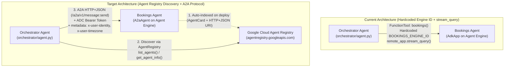

# Agent Registry Discovery & A2A Communication Plan (`orchestrator` → `bookings`)

## Overview

Currently, the **Orchestrator Agent** (`orchestrator/agent.py`) communicates with the **Bookings Agent** (`bookings/agent.py`) via a synchronous `FunctionTool` (`bookings()`) that uses a hardcoded Reasoning Engine resource ID (`BOOKINGS_ENGINE_ID`) and calls the proprietary Vertex AI SDK `remote_app.stream_query(...)` method.

This plan replaces hardcoded engine IDs and direct `stream_query` RPCs with:
1. **A2A Protocol Exposure (`bookings`):** Packaging and deploying the `bookings` agent on Vertex AI Agent Engine using `vertexai.preview.reasoning_engines.A2aAgent` and `AdkAgentToA2AExecutor` so it serves an A2A-compliant `AgentCard` and HTTP+JSON A2A endpoints (`/a2a/v1/card`, `/a2a/v1/message:send`, etc.).
2. **Dynamic Discovery via Google Cloud Agent Registry (`orchestrator`):** Using `google.adk.integrations.agent_registry.AgentRegistry` (`agentregistry.googleapis.com/v1alpha`) inside `orchestrator` to dynamically discover the `bookings` agent by display name/protocol or registry resource name at runtime instead of relying on `BOOKINGS_ENGINE_ID`.
3. **A2A Communication & Security Context Propagation (`orchestrator` → `bookings`):** Connecting `orchestrator` to `bookings` via `RemoteA2aAgent` (either as a sub-agent or wrapped in `AgentTool`) with:
   - **Data-Plane IAM Auth:** Automatic Google Cloud ADC Bearer token injection on the `httpx.AsyncClient`.
   - **End-User Identity & Timezone Forwarding:** Propagating `x-user-identity` (the IAP JWT) and `x-user-timezone` from the orchestrator's `InvocationContext.run_config.custom_metadata` into the outgoing A2A `MessageSendParams.metadata` via `a2a_request_meta_provider`, and extracting it on the `bookings` side for zero-trust JWT verification.

---

## Documentation References

### Google Cloud & Vertex AI Agent Engine Documentation
- **Vertex AI Agent Engine — A2A Agents (`A2aAgent`):** `vertexai.preview.reasoning_engines.A2aAgent` wraps an `a2a.types.AgentCard` and an `a2a.server.agent_execution.AgentExecutor` builder. During `A2aAgent.set_up()` on Agent Engine, it automatically populates `agent_card.url` with `https://{location}-aiplatform.googleapis.com/v1beta1/projects/{project}/locations/{location}/reasoningEngines/{engine_id}/a2a` and registers the `AgentCard` with Google Cloud Agent Registry.
- **Google Cloud Agent Registry API (`agentregistry.googleapis.com`):** Regional discovery service (`v1alpha/projects/{project}/locations/{location}/agents`) that automatically indexes Reasoning Engines deployed with `A2aAgent`, including their `protocols`, `skills`, `displayName`, and connection `interfaces`.
  - CLI reference: `gcloud alpha agent-registry agents list --location=us-central1` / `gcloud alpha agent-registry agents search --location=us-central1`

### Library Documentation (`google-adk==1.34.3` & `a2a-sdk==0.3.26`)
- **`google.adk.integrations.agent_registry.AgentRegistry`:**
  - `list_agents(filter_str=..., page_size=...)`: Queries `/v1alpha/projects/{project_id}/locations/{location}/agents`.
  - `get_agent_info(name)`: Fetches the Agent Registry metadata dictionary for `projects/{project}/locations/{location}/agents/{agent_id}`.
  - `get_remote_a2a_agent(name, httpx_client=...)`: Constructs a `RemoteA2aAgent` pre-configured with an `AgentCard` constructed from the Agent Registry entry (`preferred_transport="HTTP+JSON"`, `url=uri`).
- **`google.adk.agents.remote_a2a_agent.RemoteA2aAgent`:**
  - Accepts `a2a_request_meta_provider: Callable[[InvocationContext, A2AMessage], dict[str, Any]]` to inject per-request metadata into `MessageSendParams(message=..., metadata=request_metadata)`.
- **`google.adk.a2a.executor.a2a_agent_executor.A2aAgentExecutor` & `request_converter.py`:**
  - Converts incoming A2A `RequestContext` into an ADK `AgentRunRequest`. By default, `convert_a2a_request_to_agent_run_request` maps `request.metadata` into `RunConfig(custom_metadata={'a2a_metadata': request.metadata})`.

---

## Current State

### 1. `orchestrator` (`orchestrator/agent.py`, `orchestrator/deploy_agent_engine.py`)
- **[orchestrator/agent.py](file:///Users/yannipeng/git-projects/agent-security-patterns/orchestrator/agent.py#L22-L24)** reads `ENGINE_ID = os.environ.get("BOOKINGS_ENGINE_ID")`.
- **[`bookings`](file:///Users/yannipeng/git-projects/agent-security-patterns/orchestrator/agent.py#L46-L108)** is a synchronous Python function tool on the orchestrator `Agent` that:
  1. Validates the caller's IAP JWT via `get_jwt_user_id(tool_context)`.
  2. Instantiates `remote_app = agent_engines.get(ENGINE_ID)`.
  3. Calls `remote_app.create_session(user_id=user_id)` and `remote_app.stream_query(..., run_config={"custom_metadata": headers})`.
- **[orchestrator/deploy_agent_engine.py](file:///Users/yannipeng/git-projects/agent-security-patterns/orchestrator/deploy_agent_engine.py#L64-L69)** requires `BOOKINGS_ENGINE_ID` to be set at deploy time and injects it into `env_vars`.

### 2. `bookings` (`bookings/agent.py`, `bookings/app.py`, `bookings/agent_executor.py`, `bookings/deploy_agent_engine.py`)
- **[bookings/agent_executor.py](file:///Users/yannipeng/git-projects/agent-security-patterns/bookings/agent_executor.py#L1-L26)** already defines [`AdkAgentToA2AExecutor`](file:///Users/yannipeng/git-projects/agent-security-patterns/bookings/agent_executor.py#L10-L25) subclassing `A2aAgentExecutor` with a lazy `Runner`.
- **[bookings/agent.py](file:///Users/yannipeng/git-projects/agent-security-patterns/bookings/agent.py#L14-L16)** already imports `AgentCapabilities`, `AgentCard`, `AgentSkill`, and `TransportProtocol`, and defines [`create_agent()`](file:///Users/yannipeng/git-projects/agent-security-patterns/bookings/agent.py#L121-L133), though no `AgentCard` factory is wired up yet.
- **[bookings/app.py](file:///Users/yannipeng/git-projects/agent-security-patterns/bookings/app.py#L1-L16)** currently wraps `create_agent()` in `AdkApp` rather than `A2aAgent`:
  ```python
  app = AdkApp(agent=create_agent())
  ```
- **[bookings/deploy_agent_engine.py](file:///Users/yannipeng/git-projects/agent-security-patterns/bookings/deploy_agent_engine.py#L22-L26)** does not include `a2a-sdk` in `REQUIREMENTS` and deploys `AdkApp` instead of `A2aAgent`.

### 3. Architecture Comparison



---

## 📋 Checklist

- [x] **Phase 1: Expose `bookings` as an A2A Agent on Agent Engine**
  - [x] Add `create_bookings_agent_card()` in `bookings/agent.py` with `preferred_transport=TransportProtocol.http_json`.
  - [x] Update `bookings/agent_executor.py` and `bookings/agent.py` to extract `x-user-identity` and `x-user-timezone` from both `custom_metadata` and `custom_metadata["a2a_metadata"]`.
  - [x] Update `bookings/app.py` to export `a2a_app = A2aAgent(agent_card=..., agent_executor_builder=...)` alongside `app` (for local ADK playground compatibility).
  - [x] Update `bookings/deploy_agent_engine.py` to include `a2a-sdk` in `REQUIREMENTS` and deploy `a2a_app`.
- [ ] **Phase 2: Enable Agent Registry API & IAM Permissions**
  - [ ] Enable `agentregistry.googleapis.com` in the GCP project.
  - [ ] Grant `roles/agentregistry.viewer` (or `roles/aiplatform.user`) and `roles/aiplatform.user` to the Orchestrator Agent's identity (`AGENT_IDENTITY` principal / Reasoning Engine service agent) so it can query Agent Registry and invoke the Bookings A2A endpoint.
- [x] **Phase 3: Implement Dynamic Discovery & A2A Delegation in `orchestrator`**
  - [x] Add `google-adk[agent-identity]` (`google-cloud-iamconnectorcredentials`) and `a2a-sdk` to `orchestrator/pyproject.toml` and `orchestrator/deploy_agent_engine.py` `REQUIREMENTS`.
  - [x] Create `orchestrator/a2a_discovery.py` with:
    - `GoogleADCAuth(httpx.Auth)` for attaching refreshed Google Cloud ADC tokens to A2A HTTP requests.
    - `forward_user_context_metadata(ctx: InvocationContext, message: A2AMessage) -> dict[str, Any]` to propagate `x-user-identity` and `x-user-timezone` over A2A metadata.
    - `discover_bookings_a2a_agent(...)` using `AgentRegistry` (`list_agents` + `get_remote_a2a_agent`) to dynamically resolve the `bookings` agent and return a configured `RegistryDiscoveredA2aAgent` (`RemoteA2aAgent` subclass).
  - [x] Update `orchestrator/agent.py` to replace the hardcoded `bookings()` function and `BOOKINGS_ENGINE_ID` with `sub_agents=[bookings_remote_agent]`.
  - [x] Update `orchestrator/deploy_agent_engine.py` to remove the mandatory `BOOKINGS_ENGINE_ID` requirement (replacing it with optional `BOOKINGS_AGENT_DISPLAY_NAME` / `AGENT_REGISTRY_LOCATION` env vars).
- [ ] **Phase 4: Verification**
  - [ ] Deploy `bookings` and verify its registration via `gcloud alpha agent-registry agents list --location=global`.
  - [ ] Deploy `orchestrator` and verify end-to-end discovery, A2A delegation, and IAP JWT verification through `fast-api-fe`.

---

## Proposed Changes

### Phase 1: Expose `bookings` as an A2A Agent

#### 1.1 Update [bookings/agent.py](file:///Users/yannipeng/git-projects/agent-security-patterns/bookings/agent.py)
1. Update [`get_jwt_user_id`](file:///Users/yannipeng/git-projects/agent-security-patterns/bookings/agent.py#L22-L54) and [`create_calendar_invite`](file:///Users/yannipeng/git-projects/agent-security-patterns/bookings/agent.py#L75-L119) to read metadata from either `custom_metadata` directly (ADK native) or `custom_metadata.get("a2a_metadata", {})` (A2A converter default).
2. Add a [`create_bookings_agent_card()`](file:///Users/yannipeng/git-projects/agent-security-patterns/bookings/agent.py) helper that defines the `AgentCard` with `preferred_transport=TransportProtocol.http_json` (required by Vertex AI `A2aAgent`).

```python
# In bookings/agent.py

def _get_metadata_value(tool_context: ToolContext, key: str, default=None):
    """Extracts metadata from either top-level custom_metadata or nested a2a_metadata."""
    if not (
        hasattr(tool_context, "_invocation_context")
        and tool_context._invocation_context.run_config
        and tool_context._invocation_context.run_config.custom_metadata
    ):
        return default
    custom_meta = tool_context._invocation_context.run_config.custom_metadata
    if key in custom_meta:
        return custom_meta[key]
    a2a_meta = custom_meta.get("a2a_metadata")
    if isinstance(a2a_meta, dict) and key in a2a_meta:
        return a2a_meta[key]
    return default


def create_bookings_agent_card() -> AgentCard:
    """Creates the A2A AgentCard for the Bookings Assistant."""
    booking_skill = AgentSkill(
        id="manage_bookings_and_calendar",
        name="Manage Bookings and Calendar Invites",
        description=(
            "Retrieves customer travel bookings (flights, hotels) and creates "
            "Google Calendar invitations for scheduled flights or events."
        ),
        tags=["bookings", "travel", "flights", "hotels", "calendar"],
        examples=[
            "Show me my upcoming bookings.",
            "Send me a calendar invite for my flight to Tokyo.",
        ],
    )
    return AgentCard(
        name="bookings_agent",
        description="A helpful assistant for managing and viewing user bookings and calendar invites.",
        url="http://localhost:8000/a2a",  # Overwritten automatically by A2aAgent.set_up() on Agent Engine
        version="1.0.0",
        default_input_modes=["text/plain"],
        default_output_modes=["text/plain"],
        capabilities=AgentCapabilities(streaming=False),
        skills=[booking_skill],
        preferred_transport=TransportProtocol.http_json,
    )
```

#### 1.2 Update [bookings/app.py](file:///Users/yannipeng/git-projects/agent-security-patterns/bookings/app.py)
Configure `A2aAgent` for Agent Engine deployment while preserving `AdkApp` if needed for local testing:

```python
# bookings/app.py
from dotenv import load_dotenv
from vertexai.preview.reasoning_engines import A2aAgent, AdkApp
from .agent import create_agent, create_bookings_agent_card
from .agent_executor import AdkAgentToA2AExecutor

load_dotenv()

# A2A Agent wrapper for Vertex AI Agent Engine deployment & Agent Registry indexing
a2a_app = A2aAgent(
    agent_card=create_bookings_agent_card(),
    agent_executor_builder=lambda: AdkAgentToA2AExecutor(agent=create_agent()),
)

# Standard AdkApp retained for local ADK web playground compatibility
app = AdkApp(
    agent=create_agent(),
)
```

#### 1.3 Update [bookings/deploy_agent_engine.py](file:///Users/yannipeng/git-projects/agent-security-patterns/bookings/deploy_agent_engine.py)
- Import `a2a_app` from `bookings.app` instead of `app`.
- Add `"a2a-sdk>=0.3.24"` to `REQUIREMENTS` in [bookings/deploy_agent_engine.py](file:///Users/yannipeng/git-projects/agent-security-patterns/bookings/deploy_agent_engine.py#L22-L26).
- Pass `agent=a2a_app` to `client.agent_engines.create(...)` and `client.agent_engines.update(...)`.

---

### Phase 2: GCP Agent Registry API & IAM Setup

When `bookings` is deployed as an `A2aAgent` on Vertex AI Agent Engine, Google Cloud Agent Registry (`agentregistry.googleapis.com`) automatically registers the agent in the regional registry (`projects/${PROJECT_ID}/locations/${LOCATION}/agents/...`) with protocol `A2A_AGENT`.

Add a setup script or extend existing setup scripts with:

```bash
# 1. Enable Agent Registry API
gcloud services enable agentregistry.googleapis.com --project="${PROJECT_ID}"

# 2. Verify Bookings Agent appears in Agent Registry after deployment
gcloud alpha agent-registry agents list \
  --project="${PROJECT_ID}" \
  --location="${LOCATION}"
```

Ensure the runtime identity of the `orchestrator` Reasoning Engine has permission to:
1. List/Get agents in Agent Registry (`roles/agentregistry.viewer`).
2. Invoke the `bookings` Reasoning Engine A2A endpoint (`roles/aiplatform.user`).

---

### Phase 3: Dynamic Discovery & A2A Client in `orchestrator`

#### 3.1 Update Dependencies in [orchestrator/pyproject.toml](file:///Users/yannipeng/git-projects/agent-security-patterns/orchestrator/pyproject.toml) & [orchestrator/deploy_agent_engine.py](file:///Users/yannipeng/git-projects/agent-security-patterns/orchestrator/deploy_agent_engine.py)
Importing `google.adk.integrations.agent_registry` transitively imports `google.adk.integrations.agent_identity`, which requires `google-cloud-iamconnectorcredentials`.
Add to both [orchestrator/pyproject.toml](file:///Users/yannipeng/git-projects/agent-security-patterns/orchestrator/pyproject.toml) and `REQUIREMENTS` in [orchestrator/deploy_agent_engine.py](file:///Users/yannipeng/git-projects/agent-security-patterns/orchestrator/deploy_agent_engine.py#L22-L26):
- `"google-adk[agent-identity]"` (or `"google-cloud-iamconnectorcredentials"`)
- `"a2a-sdk>=0.3.24"`
- `"httpx"`

#### 3.2 Create `orchestrator/a2a_discovery.py`
Create a dedicated module in `orchestrator/` responsible for:
1. **Google Cloud Data-Plane Auth (`GoogleAuth`):** An `httpx.Auth` class that attaches `Authorization: Bearer <token>` using `google.auth.default()` credentials when calling the Vertex AI Agent Engine `/a2a` endpoint.
2. **Metadata Propagation (`build_a2a_request_meta`):** A callback for `RemoteA2aAgent._a2a_request_meta_provider` that copies `x-user-identity` (and validates it first) and `x-user-timezone` from `ctx.run_config.custom_metadata` into the A2A message metadata.
3. **Agent Registry Discovery (`create_discovered_bookings_agent`):** Queries `AgentRegistry.list_agents()` in the regional location (e.g., `us-central1`) to find the `bookings` agent by display name (`Booking Assistant` / `bookings_agent`) or configured filter without hardcoding `BOOKINGS_ENGINE_ID`.

```python
# orchestrator/a2a_discovery.py
import os
from typing import Any
import google.auth
import google.auth.transport.requests
import httpx
from a2a.types import Message as A2AMessage
from google.adk.agents.invocation_context import InvocationContext
from google.adk.agents.remote_a2a_agent import RemoteA2aAgent
from google.adk.integrations.agent_registry import AgentRegistry


class GoogleADCAuth(httpx.Auth):
    """Attaches a refreshed Google Cloud Bearer token to outgoing A2A HTTP requests."""

    def __init__(self):
        self._credentials, _ = google.auth.default(
            scopes=["https://www.googleapis.com/auth/cloud-platform"]
        )
        self._auth_request = google.auth.transport.requests.Request()

    def auth_flow(self, request: httpx.Request):
        if not self._credentials.valid:
            self._credentials.refresh(self._auth_request)
        request.headers["Authorization"] = f"Bearer {self._credentials.token}"
        yield request


def forward_user_context_metadata(
    ctx: InvocationContext, message: A2AMessage
) -> dict[str, Any]:
    """Propagates x-user-identity (IAP JWT) and x-user-timezone into A2A request metadata."""
    metadata: dict[str, Any] = {}
    if ctx.run_config and ctx.run_config.custom_metadata:
        custom_meta = ctx.run_config.custom_metadata
        for key in ("x-user-identity", "x-user-timezone"):
            if key in custom_meta and custom_meta[key]:
                metadata[key] = custom_meta[key]
    return metadata


def discover_bookings_a2a_agent(
    project_id: str,
    location: str,
    target_display_name: str = "Booking Assistant",
) -> RemoteA2aAgent:
    """Discovers the Bookings agent via Google Cloud Agent Registry and returns a RemoteA2aAgent."""
    registry = AgentRegistry(project_id=project_id, location=location)

    # 1. If a specific Agent Registry resource name is provided, use it directly;
    #    otherwise dynamically search the regional Agent Registry.
    agent_registry_name = os.environ.get("BOOKINGS_AGENT_REGISTRY_NAME")
    if not agent_registry_name:
        response = registry.list_agents()
        agents = response.get("agents", [])
        matched_agent = None
        for entry in agents:
            display_name = entry.get("displayName", "")
            card_name = entry.get("card", {}).get("content", {}).get("name", "")
            if (
                target_display_name.lower() in display_name.lower()
                or "booking" in display_name.lower()
                or "booking" in card_name.lower()
            ):
                matched_agent = entry
                break

        if not matched_agent:
            raise RuntimeError(
                f"Could not discover '{target_display_name}' in Agent Registry "
                f"(project={project_id}, location={location}). Found: "
                f"{[a.get('displayName') for a in agents]}"
            )
        agent_registry_name = matched_agent["name"]

    # 2. Construct authenticated httpx.AsyncClient for Vertex AI A2A data-plane calls
    httpx_client = httpx.AsyncClient(
        auth=GoogleADCAuth(),
        timeout=httpx.Timeout(120.0),
    )

    # 3. Build RemoteA2aAgent from the discovered Agent Registry entry
    remote_agent = registry.get_remote_a2a_agent(
        name=agent_registry_name,
        httpx_client=httpx_client,
    )
    # Attach metadata provider so x-user-identity & x-user-timezone flow over A2A
    remote_agent._a2a_request_meta_provider = forward_user_context_metadata
    return remote_agent
```

#### 3.3 Update [orchestrator/agent.py](file:///Users/yannipeng/git-projects/agent-security-patterns/orchestrator/agent.py)
Replace the hardcoded `bookings(request: str, tool_context: ToolContext)` function tool with the discovered `RemoteA2aAgent` attached via `sub_agents=[bookings_remote_agent]`.

Attaching `bookings_remote_agent` to `sub_agents` allows `RemoteA2aAgent._run_async_impl` to inherit the parent `InvocationContext` directly (including `ctx.run_config.custom_metadata` with `x-user-identity` and `x-user-timezone`), avoiding the `run_config` drop that occurs inside `AgentTool.run_async`.

```python
# In orchestrator/agent.py
from .a2a_discovery import discover_bookings_a2a_agent

def create_agent() -> Agent:
    project_id = os.environ.get("GOOGLE_CLOUD_PROJECT")
    # Note: Agent Registry is regional (e.g., us-central1), whereas GOOGLE_CLOUD_LOCATION
    # in agent.py is set to "global" for Gemini 3.8 Flash.
    registry_location = os.environ.get("LOCATION") or os.environ.get("AGENT_REGISTRY_LOCATION", "us-central1")
    target_name = os.environ.get("BOOKINGS_AGENT_DISPLAY_NAME", "Booking Assistant")

    bookings_remote_agent = discover_bookings_a2a_agent(
        project_id=project_id,
        location=registry_location,
        target_display_name=target_name,
    )

    return Agent(
        name="orchestrator",
        model=UncachedGemini(
            model="gemini-3.8-flash",
            retry_options=types.HttpRetryOptions(attempts=3),
        ),
        description="Main orchestrator agent that routes user requests to specialized subagents.",
        instruction="""You are the main orchestrator agent. Your primary goal is to understand the user's intent and route their request to the appropriate specialized subagent.
        
        Currently, you have access to the following subagents:
        1. **Bookings Agent**: Transfer to the bookings subagent for any requests related to travel bookings, hotel reservations, flight scheduling, or calendar invites.
        
        If a user's request doesn't match any specialized subagent, try to help them directly or ask for clarification.
        """,
        sub_agents=[bookings_remote_agent],
        tools=[
            LongRunningFunctionTool(func=request_user_input),
        ],
    )
```

#### 3.4 Location Environment Variable Handling
Notice a critical subtlety in [orchestrator/agent.py](file:///Users/yannipeng/git-projects/agent-security-patterns/orchestrator/agent.py#L80):
- `os.environ["GOOGLE_CLOUD_LOCATION"] = "global"` is set at module import time so that `gemini-3.8-flash` resolves against the global Vertex AI endpoint.
- However, **Vertex AI Agent Engine and Agent Registry live in a regional location** (`us-central1`).
- Therefore, `discover_bookings_a2a_agent` must use `LOCATION` / `AGENT_REGISTRY_LOCATION` (defaulting to `"us-central1"`) rather than `GOOGLE_CLOUD_LOCATION="global"`.

---

## Trade-offs & Considerations

### 1. Why `sub_agents=[RemoteA2aAgent]` Was Selected Over `AgentTool`
- **`sub_agents=[bookings_remote_agent]` (Selected):**
  - **Automatic `run_config.custom_metadata` Inheritance:** `RemoteA2aAgent._run_async_impl` receives the parent `InvocationContext` directly, so `ctx.run_config.custom_metadata` (`x-user-identity` and `x-user-timezone`) is passed straight into `a2a_request_meta_provider` without extra wrapper classes.
  - **Lower Latency:** Eliminates the extra LLM synthesis pass after the A2A response returns.
- **`AgentTool(agent=bookings_remote_agent)` (Alternative):**
  - `AgentTool.run_async` creates a child `Runner` and calls `runner.run_async(...)` without forwarding `run_config`, which drops `custom_metadata` unless a custom `AgentTool` subclass or state-copying callback is added.

### 2. Discovery Timing & Event-Loop Safety in Agent Engine
- Because [orchestrator/app.py](file:///Users/yannipeng/git-projects/agent-security-patterns/orchestrator/app.py) passes `agent=create_agent` (the factory callable) to `AdkApp(agent=create_agent)`, `create_agent()` is invoked inside the worker process on Agent Engine rather than pickled as an already-instantiated `httpx.AsyncClient` at deploy time.
- Additionally, inside `forward_user_context_metadata`, token validation (`validate_token(received_token, IAP_EXPECTED_AUDIENCE)`) runs before the outgoing A2A request is dispatched, preserving the zero-trust check on the orchestrator side.

### 3. Interaction with Model Armor & Agent Gateway (`booking-agent-gateway`)
- Currently, `bookings` and `orchestrator` are bound to `booking-agent-gateway` (`CLIENT_TO_AGENT` path).
- Verify during Phase 4 testing that A2A HTTP+JSON calls (`https://us-central1-aiplatform.googleapis.com/v1beta1/.../reasoningEngines/{id}/a2a/v1/message:send`) work seamlessly with `agent_gateway_config` and `AGENT_IDENTITY`.

---

## Next Steps

Please review this plan and let me know:
1. **Delegation Pattern:** Do you prefer wrapping the discovered `RemoteA2aAgent` in `AgentTool` (preserving the current orchestrator tool-call pattern) or registering it in `sub_agents` (using `transfer_to_agent`)?
2. **Lazy Runtime Discovery (`RegistryDiscoveredA2aAgent`):** Should discovery from `AgentRegistry` happen lazily on first request inside Agent Engine (avoiding `cloudpickle` issues during `deploy_agent_engine.py` and allowing dynamic discovery without redeploying `orchestrator` if `bookings` is re-created)?
3. Once approved, implementation can proceed across `bookings/` and `orchestrator/`.
