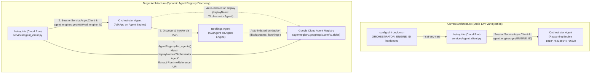
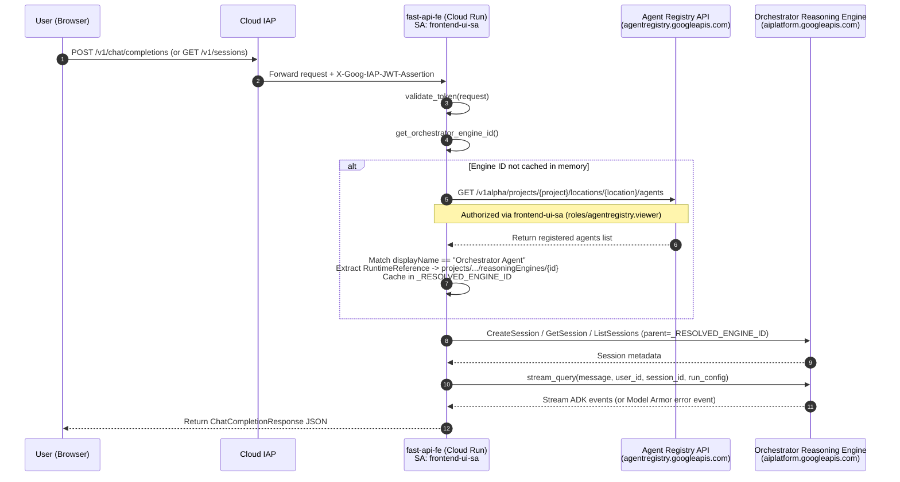

# Plan: Discover Orchestrator Agent via Agent Registry in `fast-api-fe`

## 1. Analysis & Context

### 1.1 Current State in `fast-api-fe`
Currently, the FastAPI web frontend ([`fast-api-fe`](file:///Users/yannipeng/git-projects/agent-security-patterns/fast-api-fe)) is tightly coupled to a static Vertex AI Reasoning Engine resource ID injected via the `ORCHESTRATOR_ENGINE_ID` environment variable:

1. **Deployment Injection ([`fast-api-fe/deploy.sh`](file:///Users/yannipeng/git-projects/agent-security-patterns/fast-api-fe/deploy.sh#L15) & [`config.sh`](file:///Users/yannipeng/git-projects/agent-security-patterns/config.sh#L30)):**
   - [`config.sh`](file:///Users/yannipeng/git-projects/agent-security-patterns/config.sh#L30) hardcodes `export ORCHESTRATOR_ENGINE_ID="projects/48196429354/locations/us-central1/reasoningEngines/1818476233864773632"`.
   - [`fast-api-fe/deploy.sh`](file:///Users/yannipeng/git-projects/agent-security-patterns/fast-api-fe/deploy.sh#L15) passes `ORCHESTRATOR_ENGINE_ID=${ORCHESTRATOR_ENGINE_ID}` into `--set-env-vars` during `gcloud run deploy`.
2. **Module-Level Static Binding ([`fast-api-fe/services/agent_client.py`](file:///Users/yannipeng/git-projects/agent-security-patterns/fast-api-fe/services/agent_client.py#L13-L20)):**
   - `ENGINE_ID = os.environ.get("ORCHESTRATOR_ENGINE_ID")` is evaluated once at import time.
   - Five operations in [`fast-api-fe/services/agent_client.py`](file:///Users/yannipeng/git-projects/agent-security-patterns/fast-api-fe/services/agent_client.py) depend on this Reasoning Engine resource name (`projects/{project}/locations/{location}/reasoningEngines/{id}`):
     - [`query_agent()`](file:///Users/yannipeng/git-projects/agent-security-patterns/fast-api-fe/services/agent_client.py#L57-L60): `aiplatform_v1.CreateSessionRequest(parent=engine_id, ...)`
     - [`query_agent()`](file:///Users/yannipeng/git-projects/agent-security-patterns/fast-api-fe/services/agent_client.py#L72-L73): `session_client.get_session(name=f"{engine_id}/sessions/{session_id}")` (IDOR session ownership verification)
     - [`query_agent()`](file:///Users/yannipeng/git-projects/agent-security-patterns/fast-api-fe/services/agent_client.py#L79-L95): `agent_engines.get(engine_id).stream_query(...)`
     - [`list_user_sessions()`](file:///Users/yannipeng/git-projects/agent-security-patterns/fast-api-fe/services/agent_client.py#L247-L253): `aiplatform_v1.ListSessionsRequest(parent=engine_id, filter=f'user_id="{user_id}"')`
     - [`get_session_history()`](file:///Users/yannipeng/git-projects/agent-security-patterns/fast-api-fe/services/agent_client.py#L271-L283): `client.get_session(name=session_name)` and `aiplatform_v1.ListEventsRequest(parent=session_name)`

### 1.2 How the Orchestrator Agent is Indexed in Google Cloud Agent Registry
When [`orchestrator/deploy_agent_engine.py`](file:///Users/yannipeng/git-projects/agent-security-patterns/orchestrator/deploy_agent_engine.py#L17) deploys the Orchestrator `AdkApp` (`DISPLAY_NAME = "Orchestrator Agent"`), Vertex AI Agent Engine automatically registers the agent in Google Cloud Agent Registry (`agentregistry.googleapis.com/v1alpha`).

Inspecting the live Agent Registry entry in `projects/agent-security-patterns/locations/us-central1/agents` reveals the exact schema for the deployed Orchestrator Agent:

```json
{
  "agentId": "urn:agent:projects-48196429354:projects:48196429354:locations:us-central1:aiplatform:reasoningEngines:1818476233864773632",
  "attributes": {
    "agentregistry.googleapis.com/system/Framework": {
      "framework": "google-adk"
    },
    "agentregistry.googleapis.com/system/RuntimeIdentity": {
      "principal": "principal://agents.global.org-419713829424.system.id.goog/resources/aiplatform/projects/48196429354/locations/us-central1/reasoningEngines/1818476233864773632"
    },
    "agentregistry.googleapis.com/system/RuntimeReference": {
      "uri": "//aiplatform.googleapis.com/projects/48196429354/locations/us-central1/reasoningEngines/1818476233864773632"
    }
  },
  "description": "Main orchestrator agent that routes user requests to specialized subagents.",
  "displayName": "Orchestrator Agent",
  "location": "us-central1",
  "name": "projects/agent-security-patterns/locations/us-central1/agents/agentregistry-00000000-0000-0000-044a-dbee2e66510f",
  "protocols": [
    {
      "interfaces": [
        {
          "protocolBinding": "HTTP_JSON",
          "url": "https://us-central1-aiplatform.googleapis.com/v1/projects/48196429354/locations/us-central1/reasoningEngines/1818476233864773632:query"
        },
        {
          "protocolBinding": "HTTP_JSON",
          "url": "https://us-central1-aiplatform.googleapis.com/v1/projects/48196429354/locations/us-central1/reasoningEngines/1818476233864773632:streamQuery"
        }
      ],
      "type": "CUSTOM"
    }
  ],
  "uid": "agentregistry-00000000-0000-0000-044a-dbee2e66510f"
}
```

### 1.3 Key Technical Findings & Constraints
1. **`AdkApp` (`CUSTOM` Protocol) vs. `A2aAgent` (`A2A_AGENT` Protocol):**
   - Unlike the Bookings Agent (`protocols[].type == "A2A_AGENT"`), the Orchestrator Agent is deployed as an `AdkApp` (`protocols[].type == "CUSTOM"`) because `fast-api-fe` relies on stateful Vertex AI Agent Engine Sessions (`CreateSession`, `GetSession`, `ListSessions`, `ListEvents`) and streaming queries (`stream_query`) with `LongRunningFunctionTool` (`request_user_input`) and Model Armor error event extraction.
   - Consequently, `AgentRegistry.get_remote_a2a_agent()` (which only looks for `protocol_type == "A2A_AGENT"`) is not applicable here. Instead, `fast-api-fe` should use `AgentRegistry.list_agents()` / `AgentRegistry.get_agent_info()` to discover the `"Orchestrator Agent"` entry in Agent Registry and extract its canonical Reasoning Engine resource name (`projects/48196429354/locations/us-central1/reasoningEngines/1818476233864773632`).
2. **Extracting the Reasoning Engine Resource Name from the Agent Registry Entry:**
   - **Primary Path (`attributes`):** `entry["attributes"]["agentregistry.googleapis.com/system/RuntimeReference"]["uri"]` contains `"//aiplatform.googleapis.com/projects/48196429354/locations/us-central1/reasoningEngines/1818476233864773632"`. Stripping the leading `"//aiplatform.googleapis.com/"` prefix yields the exact Reasoning Engine resource name.
   - **Fallback Path 1 (`protocols[].interfaces[].url`):** Regex matching `r"(projects/[^/]+/locations/[^/]+/reasoningEngines/[^/:]+)"` against each interface `url` extracts `projects/48196429354/locations/us-central1/reasoningEngines/1818476233864773632`.
   - **Fallback Path 2 (`agentId` URN):** Parsing `urn:agent:...:projects:{p}:locations:{l}:aiplatform:reasoningEngines:{id}` reconstructs `projects/{p}/locations/{l}/reasoningEngines/{id}`.
3. **Transitive Dependencies of `google.adk.integrations.agent_registry`:**
   - [`fast-api-fe/pyproject.toml`](file:///Users/yannipeng/git-projects/agent-security-patterns/fast-api-fe/pyproject.toml#L11) already includes `google-adk>=1.39.1,<2.0.0`.
   - However, [`google/adk/integrations/agent_registry/agent_registry.py`](file:///Users/yannipeng/git-projects/agent-security-patterns/.venv/lib/python3.12/site-packages/google/adk/integrations/agent_registry/agent_registry.py#L34-L58) unconditionally imports `GcpAuthProviderScheme` (requiring `google-cloud-iamconnectorcredentials`) and `a2a.types` (requiring `a2a-sdk`) at module load time.
   - Therefore, `a2a-sdk~=0.3.22` and `google-cloud-iamconnectorcredentials>=0.1.2` must be added to [`fast-api-fe/pyproject.toml`](file:///Users/yannipeng/git-projects/agent-security-patterns/fast-api-fe/pyproject.toml), matching [`orchestrator/pyproject.toml`](file:///Users/yannipeng/git-projects/agent-security-patterns/orchestrator/pyproject.toml#L9-L10).
4. **Cloud Run Service Account IAM Permissions (`frontend-ui-sa`):**
   - `fast-api-fe` runs on Cloud Run as standard IAM service account `frontend-ui-sa@agent-security-patterns.iam.gserviceaccount.com` (standard OAuth2 ADC token, not `AGENT_IDENTITY` mTLS).
   - Previously, `frontend-ui-sa` had `roles/discoveryengine.viewer` and `roles/logging.logWriter`, **but lacked `roles/agentregistry.viewer`**.
   - Note that [`fast-api-fe/deploy.sh`](file:///Users/yannipeng/git-projects/agent-security-patterns/fast-api-fe/deploy.sh) only deploys the Cloud Run revision and does **not** automatically invoke [`setup-scripts/grant-frontend-ui-roles.sh`](file:///Users/yannipeng/git-projects/agent-security-patterns/setup-scripts/grant-frontend-ui-roles.sh). If `fast-api-fe` is deployed before executing [`setup-scripts/grant-frontend-ui-roles.sh`](file:///Users/yannipeng/git-projects/agent-security-patterns/setup-scripts/grant-frontend-ui-roles.sh), the first call to `resolve_orchestrator_engine_id()` -> `registry.list_agents()` fails immediately with `HTTP 403 PERMISSION_DENIED` (`Permission 'agentregistry.agents.list' denied on resource '//agentregistry.googleapis.com/projects/agent-security-patterns/locations/us-central1'`).
   - [`setup-scripts/grant-frontend-ui-roles.sh`](file:///Users/yannipeng/git-projects/agent-security-patterns/setup-scripts/grant-frontend-ui-roles.sh) must be updated and executed to bind `roles/agentregistry.viewer` (and `roles/aiplatform.user`) to `serviceAccount:${FRONTEND_UI_SA_EMAIL}`.

---

## 2. Overview

This plan removes the hardcoded `ORCHESTRATOR_ENGINE_ID` environment variable from [`fast-api-fe`](file:///Users/yannipeng/git-projects/agent-security-patterns/fast-api-fe) and replaces it with dynamic runtime discovery via **Google Cloud Agent Registry** (`google.adk.integrations.agent_registry.AgentRegistry`).

Key changes include:
- Creating a discovery helper (`resolve_orchestrator_engine_id()`) in [`fast-api-fe/services/agent_client.py`](file:///Users/yannipeng/git-projects/agent-security-patterns/fast-api-fe/services/agent_client.py) that queries `AgentRegistry` in `(PROJECT_ID, LOCATION)` for the Orchestrator Agent by display name (`ORCHESTRATOR_AGENT_DISPLAY_NAME`, default `"Orchestrator Agent"`) or registry resource name (`ORCHESTRATOR_AGENT_REGISTRY_NAME`), extracts the Reasoning Engine resource name, and caches it in memory with thread-safe lazy initialization.
- Updating [`query_agent()`](file:///Users/yannipeng/git-projects/agent-security-patterns/fast-api-fe/services/agent_client.py#L33), [`list_user_sessions()`](file:///Users/yannipeng/git-projects/agent-security-patterns/fast-api-fe/services/agent_client.py#L237), and [`get_session_history()`](file:///Users/yannipeng/git-projects/agent-security-patterns/fast-api-fe/services/agent_client.py#L264) to obtain the engine resource name via `get_orchestrator_engine_id()` instead of a module-level `ORCHESTRATOR_ENGINE_ID` constant.
- Updating [`fast-api-fe/pyproject.toml`](file:///Users/yannipeng/git-projects/agent-security-patterns/fast-api-fe/pyproject.toml), [`fast-api-fe/deploy.sh`](file:///Users/yannipeng/git-projects/agent-security-patterns/fast-api-fe/deploy.sh), [`setup-scripts/grant-frontend-ui-roles.sh`](file:///Users/yannipeng/git-projects/agent-security-patterns/setup-scripts/grant-frontend-ui-roles.sh), and [`fast-api-fe/README.md`](file:///Users/yannipeng/git-projects/agent-security-patterns/fast-api-fe/README.md) so Cloud Run deployments no longer require `ORCHESTRATOR_ENGINE_ID`.

---

## 3. Mermaid Diagrams

### 3.1 Architecture Comparison (Before vs. After)



### 3.2 Runtime Discovery & Request Sequence Flow



---

## 4. List of Tasks to Complete

- [x] **Task 1: Update `fast-api-fe` Dependencies**
  - [x] **1.1** Add `"a2a-sdk~=0.3.22"` and `"google-cloud-iamconnectorcredentials>=0.1.2"` to [`fast-api-fe/pyproject.toml`](file:///Users/yannipeng/git-projects/agent-security-patterns/fast-api-fe/pyproject.toml) so `google.adk.integrations.agent_registry.AgentRegistry` can be imported inside the `fast-api-fe` container without missing transitive dependencies.
  - [x] **1.2** Run `uv lock` / `uv sync` at the workspace root to validate dependency resolution.
- [x] **Task 2: Implement Agent Registry Discovery in [`fast-api-fe/services/agent_client.py`](file:///Users/yannipeng/git-projects/agent-security-patterns/fast-api-fe/services/agent_client.py)**
  - [x] **2.1** Add `_extract_reasoning_engine_id_from_agent_entry(entry: dict) -> Optional[str]` to parse the Reasoning Engine resource name from:
    1. `attributes["agentregistry.googleapis.com/system/RuntimeReference"]["uri"]`
    2. `protocols[].interfaces[].url`
    3. `agentId` URN
  - [x] **2.2** Add `resolve_orchestrator_engine_id(...) -> str` using `AgentRegistry(project_id=..., location=...)` to look up the Orchestrator Agent by `ORCHESTRATOR_AGENT_REGISTRY_NAME` (if set) or `ORCHESTRATOR_AGENT_DISPLAY_NAME` (default `"Orchestrator Agent"`).
  - [x] **2.3** Add `get_orchestrator_engine_id(force_refresh: bool = False) -> str` with in-memory caching (`_RESOLVED_ENGINE_ID`) and optional `ORCHESTRATOR_ENGINE_ID` override fallback for local testing/backward compatibility.
  - [x] **2.4** Update [`query_agent()`](file:///Users/yannipeng/git-projects/agent-security-patterns/fast-api-fe/services/agent_client.py#L180), [`list_user_sessions()`](file:///Users/yannipeng/git-projects/agent-security-patterns/fast-api-fe/services/agent_client.py#L386), and [`get_session_history()`](file:///Users/yannipeng/git-projects/agent-security-patterns/fast-api-fe/services/agent_client.py#L414) to call `get_orchestrator_engine_id()` instead of referencing a static `ENGINE_ID` global variable.
- [x] **Task 3: Update IAM Grant Scripts & Cloud Run Deployment Configuration**
  - [x] **3.1** Update [`setup-scripts/grant-frontend-ui-roles.sh`](file:///Users/yannipeng/git-projects/agent-security-patterns/setup-scripts/grant-frontend-ui-roles.sh) to grant `roles/agentregistry.viewer` and `roles/aiplatform.user` to `serviceAccount:${FRONTEND_UI_SA_EMAIL}`.
  - [x] **3.2** Update [`fast-api-fe/deploy.sh`](file:///Users/yannipeng/git-projects/agent-security-patterns/fast-api-fe/deploy.sh) to remove `ORCHESTRATOR_ENGINE_ID=${ORCHESTRATOR_ENGINE_ID}` from `--set-env-vars` and pass `ORCHESTRATOR_AGENT_DISPLAY_NAME=${ORCHESTRATOR_AGENT_DISPLAY_NAME:-Orchestrator Agent}` instead.
  - [x] **3.3** Update [`config.sh`](file:///Users/yannipeng/git-projects/agent-security-patterns/config.sh) comments/variables to add `export ORCHESTRATOR_AGENT_DISPLAY_NAME="Orchestrator Agent"` and note that `ORCHESTRATOR_ENGINE_ID` is no longer required by `fast-api-fe`.
  - [x] **3.4** Update [`fast-api-fe/README.md`](file:///Users/yannipeng/git-projects/agent-security-patterns/fast-api-fe/README.md) documentation and architecture diagram to reflect Agent Registry discovery.
- [x] **Task 4: Add Unit Tests for Orchestrator Discovery & Client Integration**
  - [x] **4.1** Add unit tests in [`tests/test_orchestrator_discovery.py`](file:///Users/yannipeng/git-projects/agent-security-patterns/tests/test_orchestrator_discovery.py) covering `_extract_reasoning_engine_id_from_agent_entry()`, `resolve_orchestrator_engine_id()`, caching in `get_orchestrator_engine_id()`, error handling when the agent is not found, and integration with `query_agent()`, `list_user_sessions()`, and `get_session_history()`.
  - [x] **4.2** Run `uv run pytest` and verify all existing and new tests pass.
- [ ] **Task 5: Apply IAM Grant, Rebuild & Redeploy `fast-api-fe`**
  - [x] **5.1** Execute [`setup-scripts/grant-frontend-ui-roles.sh`](file:///Users/yannipeng/git-projects/agent-security-patterns/setup-scripts/grant-frontend-ui-roles.sh) to grant `roles/agentregistry.viewer` to `frontend-ui-sa`.
  - [ ] **5.2** Build container image via [`fast-api-fe/build-on-cloud-build.sh`](file:///Users/yannipeng/git-projects/agent-security-patterns/fast-api-fe/build-on-cloud-build.sh) and deploy via [`fast-api-fe/deploy.sh`](file:///Users/yannipeng/git-projects/agent-security-patterns/fast-api-fe/deploy.sh).

---

## 5. Code Snippets

### 5.1 [`fast-api-fe/pyproject.toml`](file:///Users/yannipeng/git-projects/agent-security-patterns/fast-api-fe/pyproject.toml)

```toml
[project]
name = "fast-api-fe"
version = "0.1.0"
description = "Chat UI and Agent Gateway"
requires-python = ">=3.10"
dependencies = [
    "fastapi>=0.115.0",
    "uvicorn[standard]>=0.29.0",
    "jinja2>=3.1.0",
    "python-multipart>=0.0.9",
    "google-adk>=1.39.1,<2.0.0",
    "google-cloud-iamconnectorcredentials>=0.1.2",
    "a2a-sdk~=0.3.22",
    "google-cloud-aiplatform[agent-engines]>=1.130.0",
    "google-auth>=2.29.0",
    "httpx>=0.27.0",
    "PyJWT>=2.8.0",
]
```

### 5.2 Discovery Logic in [`fast-api-fe/services/agent_client.py`](file:///Users/yannipeng/git-projects/agent-security-patterns/fast-api-fe/services/agent_client.py)

```python
import re
from typing import Any, Optional, List, Dict
from google.adk.integrations.agent_registry import AgentRegistry

PROJECT_ID = os.environ.get("PROJECT_ID") or os.environ.get("GOOGLE_CLOUD_PROJECT")
LOCATION = os.environ.get("LOCATION", "us-central1")
AGENT_REGISTRY_LOCATION = os.environ.get("AGENT_REGISTRY_LOCATION", LOCATION)
ORCHESTRATOR_AGENT_DISPLAY_NAME = os.environ.get(
    "ORCHESTRATOR_AGENT_DISPLAY_NAME", "Orchestrator Agent"
)

# Optional static override (used only if explicitly set in env; otherwise resolved via Agent Registry)
ENGINE_ID: Optional[str] = os.environ.get("ORCHESTRATOR_ENGINE_ID") or None
_RESOLVED_ENGINE_ID: Optional[str] = None

_REASONING_ENGINE_PATTERN = re.compile(
    r"(projects/[^/]+/locations/[^/]+/reasoningEngines/[^/:?\s]+)"
)
_URN_REASONING_ENGINE_PATTERN = re.compile(
    r"projects:([^:]+):locations:([^:]+):aiplatform:reasoningEngines:([^:\s]+)"
)


def _extract_reasoning_engine_id_from_agent_entry(
    entry: Dict[str, Any],
) -> Optional[str]:
    """Extracts the canonical Reasoning Engine resource name from an Agent Registry entry."""
    # 1. Primary: attributes['agentregistry.googleapis.com/system/RuntimeReference']['uri']
    # Format: "//aiplatform.googleapis.com/projects/48196429354/locations/us-central1/reasoningEngines/1818476233864773632"
    attributes = entry.get("attributes") or {}
    runtime_ref = attributes.get(
        "agentregistry.googleapis.com/system/RuntimeReference"
    )
    if isinstance(runtime_ref, dict):
        uri = runtime_ref.get("uri", "")
        match = _REASONING_ENGINE_PATTERN.search(uri)
        if match:
            return match.group(1)

    # 2. Fallback 1: protocols[].interfaces[].url
    # Format: "https://us-central1-aiplatform.googleapis.com/v1/projects/.../reasoningEngines/...:streamQuery"
    for protocol in entry.get("protocols") or []:
        for iface in protocol.get("interfaces") or []:
            url = iface.get("url", "")
            match = _REASONING_ENGINE_PATTERN.search(url)
            if match:
                return match.group(1)

    # 3. Fallback 2: card.content.url (if exposed as A2A card)
    card_url = (entry.get("card") or {}).get("content", {}).get("url", "")
    if card_url:
        match = _REASONING_ENGINE_PATTERN.search(card_url)
        if match:
            return match.group(1)

    # 4. Fallback 3: agentId URN
    # Format: "urn:agent:projects-48196429354:projects:48196429354:locations:us-central1:aiplatform:reasoningEngines:1818476233864773632"
    agent_id_urn = entry.get("agentId", "")
    urn_match = _URN_REASONING_ENGINE_PATTERN.search(agent_id_urn)
    if urn_match:
        proj, loc, eng_id = urn_match.groups()
        return f"projects/{proj}/locations/{loc}/reasoningEngines/{eng_id}"

    return None


def resolve_orchestrator_engine_id(
    project_id: Optional[str] = None,
    location: Optional[str] = None,
    target_display_name: Optional[str] = None,
) -> str:
    """Queries Google Cloud Agent Registry to discover the Orchestrator Reasoning Engine resource name."""
    resolved_project = project_id or PROJECT_ID
    resolved_location = location or AGENT_REGISTRY_LOCATION
    resolved_target = target_display_name or ORCHESTRATOR_AGENT_DISPLAY_NAME

    if not resolved_project:
        raise RuntimeError(
            "PROJECT_ID must be set to discover the Orchestrator Agent in Agent Registry."
        )

    registry = AgentRegistry(
        project_id=resolved_project,
        location=resolved_location,
    )

    agent_registry_name = os.environ.get("ORCHESTRATOR_AGENT_REGISTRY_NAME")
    matched_entry: Optional[Dict[str, Any]] = None

    if agent_registry_name:
        matched_entry = registry.get_agent_info(agent_registry_name)
    else:
        filter_str = os.environ.get("ORCHESTRATOR_REGISTRY_FILTER")
        response = registry.list_agents(filter_str=filter_str)
        agents = response.get("agents", [])

        # Prefer exact case-insensitive displayName match first, then substring match
        for entry in agents:
            display_name = entry.get("displayName", "")
            if display_name.lower() == resolved_target.lower():
                matched_entry = entry
                break

        if not matched_entry:
            for entry in agents:
                display_name = entry.get("displayName", "")
                if (
                    resolved_target.lower() in display_name.lower()
                    or "orchestrator" in display_name.lower()
                ):
                    matched_entry = entry
                    break

        if not matched_entry:
            raise RuntimeError(
                f"Could not discover '{resolved_target}' in Agent Registry "
                f"(project={resolved_project}, location={resolved_location}). "
                f"Found agents: {[a.get('displayName') for a in agents]}"
            )

    engine_id = _extract_reasoning_engine_id_from_agent_entry(matched_entry)
    if not engine_id:
        raise RuntimeError(
            f"Discovered Agent Registry entry '{matched_entry.get('name')}' "
            f"(displayName='{matched_entry.get('displayName')}'), but could not extract "
            "a Reasoning Engine resource ID from its metadata."
        )

    logger.info(
        "Discovered Orchestrator Agent in Agent Registry: registry_name=%s display_name=%s engine_id=%s",
        matched_entry.get("name"),
        matched_entry.get("displayName"),
        engine_id,
    )
    return engine_id


def get_orchestrator_engine_id(force_refresh: bool = False) -> str:
    """Returns the cached Orchestrator Reasoning Engine ID, discovering it via Agent Registry if needed."""
    global _RESOLVED_ENGINE_ID
    if ENGINE_ID and not force_refresh:
        return ENGINE_ID
    if _RESOLVED_ENGINE_ID and not force_refresh:
        return _RESOLVED_ENGINE_ID

    _RESOLVED_ENGINE_ID = resolve_orchestrator_engine_id()
    return _RESOLVED_ENGINE_ID
```

### 5.3 Usage in [`query_agent()`](file:///Users/yannipeng/git-projects/agent-security-patterns/fast-api-fe/services/agent_client.py#L33), [`list_user_sessions()`](file:///Users/yannipeng/git-projects/agent-security-patterns/fast-api-fe/services/agent_client.py#L237), and [`get_session_history()`](file:///Users/yannipeng/git-projects/agent-security-patterns/fast-api-fe/services/agent_client.py#L264)

```python
# Inside query_agent():
engine_id = get_orchestrator_engine_id()

# 2. Ensure we have a session ID
session_client = _get_session_client()
if not session_id or force_new:
    request = aiplatform_v1.CreateSessionRequest(
        parent=engine_id,
        session=aiplatform_v1.Session(user_id=user_id),
    )
    ...
else:
    session_name = f"{engine_id}/sessions/{session_id}"
    session = await session_client.get_session(name=session_name)
    ...

# 3. Connect to Remote Agent Engine via SDK
remote_app = agent_engines.get(engine_id)
```

```python
# Inside list_user_sessions():
async def list_user_sessions(user_id: str) -> list[dict]:
    try:
        engine_id = get_orchestrator_engine_id()
        client = _get_session_client()
        request = aiplatform_v1.ListSessionsRequest(
            parent=engine_id,
            filter=f'user_id="{user_id}"',
        )
        ...
```

```python
# Inside get_session_history():
async def get_session_history(user_id: str, session_id: str) -> list[dict]:
    try:
        engine_id = get_orchestrator_engine_id()
        client = _get_session_client()
        session_name = f"{engine_id}/sessions/{session_id}"
        ...
```

### 5.4 [`fast-api-fe/deploy.sh`](file:///Users/yannipeng/git-projects/agent-security-patterns/fast-api-fe/deploy.sh)

```bash
#!/bin/bash

# Source the shared configuration file
source ../config.sh

echo $PROJECT_ID
# Construct the full image URL
IMAGE="${LOCATION}-docker.pkg.dev/${PROJECT_ID}/${REPO_NAME}/fast-api-fe:latest"
ORCHESTRATOR_DISPLAY_NAME="${ORCHESTRATOR_AGENT_DISPLAY_NAME:-Orchestrator Agent}"

gcloud run deploy $FRONTEND_IMAGE_NAME \
  --image=$IMAGE \
  --region=$LOCATION \
  --port=8080 \
  --ingress=internal-and-cloud-load-balancing \
  --set-env-vars="PROJECT_ID=${PROJECT_ID},LOCATION=${LOCATION},AGENT_REGISTRY_LOCATION=${LOCATION},ORCHESTRATOR_AGENT_DISPLAY_NAME=${ORCHESTRATOR_DISPLAY_NAME},IAP_EXPECTED_AUDIENCE=${IAP_EXPECTED_AUDIENCE}" \
  --memory=512Mi \
  --cpu=2 \
  --no-default-url \
  --service-account="${FRONTEND_UI_SA_EMAIL}"
```

### 5.5 [`setup-scripts/grant-frontend-ui-roles.sh`](file:///Users/yannipeng/git-projects/agent-security-patterns/setup-scripts/grant-frontend-ui-roles.sh)

```bash
#!/bin/bash
set -eux

source "../config.sh"

SA_EMAIL="$FRONTEND_UI_SA_EMAIL"

# 1. Grant Log Writing access (Project Level)
gcloud projects add-iam-policy-binding $PROJECT_ID \
    --member="serviceAccount:${SA_EMAIL}" \
    --role="roles/logging.logWriter"

# 2. Grant Discovery Engine Viewer access
gcloud projects add-iam-policy-binding $PROJECT_ID \
    --member="serviceAccount:${SA_EMAIL}" \
    --role="roles/discoveryengine.viewer"

# 3. Grant Agent Registry Viewer access so fast-api-fe can discover the Orchestrator Agent
gcloud projects add-iam-policy-binding $PROJECT_ID \
    --member="serviceAccount:${SA_EMAIL}" \
    --role="roles/agentregistry.viewer"

# 4. Grant Vertex AI User access so fast-api-fe can manage sessions and query the discovered Orchestrator Engine
gcloud projects add-iam-policy-binding $PROJECT_ID \
    --member="serviceAccount:${SA_EMAIL}" \
    --role="roles/aiplatform.user"

echo "Service Account $SA_EMAIL configured successfully."
```

---

## 6. Tests

### 6.1 Unit Tests (`tests/test_agent_client_stream.py`)
Add unit test cases verifying all discovery and fallback paths without requiring live GCP network calls:

1. **`test_extract_reasoning_engine_id_from_runtime_reference()`**:
   - Feeds the exact Agent Registry JSON structure for `Orchestrator Agent` (`attributes["agentregistry.googleapis.com/system/RuntimeReference"]["uri"]`).
   - Asserts `_extract_reasoning_engine_id_from_agent_entry()` returns `"projects/48196429354/locations/us-central1/reasoningEngines/1818476233864773632"`.
2. **`test_extract_reasoning_engine_id_fallbacks()`**:
   - Tests extraction from `protocols[].interfaces[].url` (`...:streamQuery`) when `attributes` is absent.
   - Tests extraction from `agentId` URN (`urn:agent:projects-48196429354:projects:48196429354:locations:us-central1:aiplatform:reasoningEngines:1818476233864773632`) when both `attributes` and `protocols` are absent.
3. **`test_resolve_orchestrator_engine_id_matches_display_name()`**:
   - Mocks `AgentRegistry.list_agents()` returning multiple agents (`Workspace Agent`, `Orchestrator Agent`, `bookings`).
   - Asserts `resolve_orchestrator_engine_id()` selects `Orchestrator Agent` and returns its Reasoning Engine resource name.
4. **`test_resolve_orchestrator_engine_id_raises_when_missing()`**:
   - Mocks `AgentRegistry.list_agents()` returning only `Workspace Agent`.
   - Asserts `RuntimeError` is raised listing the available agent display names.
5. **`test_get_orchestrator_engine_id_caches_result()`**:
   - Verifies calling `get_orchestrator_engine_id()` multiple times invokes `resolve_orchestrator_engine_id()` only once unless `force_refresh=True` is passed.
6. **`test_session_and_query_use_discovered_engine_id()`**:
   - Verifies `list_user_sessions()`, `get_session_history()`, and `query_agent()` succeed when `ENGINE_ID` is `None` and `get_orchestrator_engine_id()` resolves the resource ID via Agent Registry.

### 6.2 End-to-End & Cloud Run Verification
1. Run `uv run pytest tests/test_agent_client_stream.py tests/test_orchestrator_discovery.py` locally and confirm all unit tests pass.
2. Verify IAM policy binding for `frontend-ui-sa` includes `roles/agentregistry.viewer`.
3. Build and deploy `fast-api-fe` to Cloud Run without `ORCHESTRATOR_ENGINE_ID` in `--set-env-vars`.
4. Inspect Cloud Run revision environment variables via `gcloud run services describe frontend-ui --region=us-central1` to confirm `ORCHESTRATOR_ENGINE_ID` is absent.
5. Send a chat request and load sessions in the UI; verify Cloud Run logs show:
   `Discovered Orchestrator Agent in Agent Registry: registry_name=projects/agent-security-patterns/locations/us-central1/agents/... display_name=Orchestrator Agent engine_id=projects/48196429354/locations/us-central1/reasoningEngines/1818476233864773632`.

### 6.3 Troubleshooting: `403 PERMISSION_DENIED` on `agentregistry.agents.list`

#### Observed Symptom
When `fast-api-fe` attempts to communicate with `orchestrator` before the IAM bindings are applied, [`query_agent()`](file:///Users/yannipeng/git-projects/agent-security-patterns/fast-api-fe/services/agent_client.py#L189) fails on its first step (`get_orchestrator_engine_id()` -> `resolve_orchestrator_engine_id()`) with:

```text
Error communicating with agent: API request failed with status 403: {
  "error": {
    "code": 403,
    "message": "Permission 'agentregistry.agents.list' denied on resource '//agentregistry.googleapis.com/projects/agent-security-patterns/locations/us-central1' (or it may not exist)...",
    "status": "PERMISSION_DENIED",
    "details": [
      {
        "@type": "type.googleapis.com/google.rpc.ErrorInfo",
        "reason": "IAM_PERMISSION_DENIED",
        "domain": "agentregistry.googleapis.com",
        "metadata": {
          "permission": "agentregistry.agents.list",
          "resource": "projects/agent-security-patterns/locations/us-central1"
        }
      }
    ]
  }
}
```

#### Root Cause
1. **Authentication vs. Authorization (`403` vs. `401`):** Reaching `403 PERMISSION_DENIED` confirms that Cloud Run authenticated properly with `agentregistry.googleapis.com` using the `frontend-ui-sa@agent-security-patterns.iam.gserviceaccount.com` service account OAuth 2.0 Bearer token (confirming that mTLS client certificates are not required on Cloud Run, unlike `IdentityType.AGENT_IDENTITY` on Vertex AI Agent Engine documented in [`plans/fix-agent-registry-discovery-auth.md`](file:///Users/yannipeng/git-projects/agent-security-patterns/plans/fix-agent-registry-discovery-auth.md)).
2. **Missing Live IAM Binding:** [`fast-api-fe/deploy.sh`](file:///Users/yannipeng/git-projects/agent-security-patterns/fast-api-fe/deploy.sh) only deploys the Cloud Run service and does not run [`setup-scripts/grant-frontend-ui-roles.sh`](file:///Users/yannipeng/git-projects/agent-security-patterns/setup-scripts/grant-frontend-ui-roles.sh). Until `grant-frontend-ui-roles.sh` is executed against the GCP project, `frontend-ui-sa` lacks `roles/agentregistry.viewer` (`agentregistry.agents.list` and `agentregistry.agents.get`).

#### Resolution
Execute [`setup-scripts/grant-frontend-ui-roles.sh`](file:///Users/yannipeng/git-projects/agent-security-patterns/setup-scripts/grant-frontend-ui-roles.sh) (no container rebuild or Cloud Run redeploy is required for IAM changes):

```bash
cd setup-scripts && ./grant-frontend-ui-roles.sh
```

Or apply the binding directly via `gcloud`:

```bash
gcloud projects add-iam-policy-binding agent-security-patterns \
    --member="serviceAccount:frontend-ui-sa@agent-security-patterns.iam.gserviceaccount.com" \
    --role="roles/agentregistry.viewer"
```

---

## 7. Success Criteria

1. **Zero Hardcoded Engine ID in Cloud Run Deployment:** [`fast-api-fe/deploy.sh`](file:///Users/yannipeng/git-projects/agent-security-patterns/fast-api-fe/deploy.sh) deploys `frontend-ui` without `ORCHESTRATOR_ENGINE_ID` in `--set-env-vars`.
2. **Dynamic Runtime Resolution via Agent Registry:** On startup or first request, [`fast-api-fe/services/agent_client.py`](file:///Users/yannipeng/git-projects/agent-security-patterns/fast-api-fe/services/agent_client.py) queries `agentregistry.googleapis.com/v1alpha` using `AgentRegistry`, locates `"Orchestrator Agent"`, extracts `projects/48196429354/locations/us-central1/reasoningEngines/1818476233864773632`, and caches it for subsequent requests.
3. **Full Feature Parity for Sessions & Streaming:** Creating new chat sessions, listing existing user sessions, loading session message history (including IDOR ownership checks), streaming agent responses, `request_user_input` prompts, and Model Armor security block alerts all function identically using the dynamically discovered Reasoning Engine ID.
4. **Least-Privilege IAM & Automated Tests:** `frontend-ui-sa` is granted `roles/agentregistry.viewer` in [`setup-scripts/grant-frontend-ui-roles.sh`](file:///Users/yannipeng/git-projects/agent-security-patterns/setup-scripts/grant-frontend-ui-roles.sh), and all unit tests in [`tests/test_agent_client_stream.py`](file:///Users/yannipeng/git-projects/agent-security-patterns/tests/test_agent_client_stream.py) pass via `uv run pytest`.
