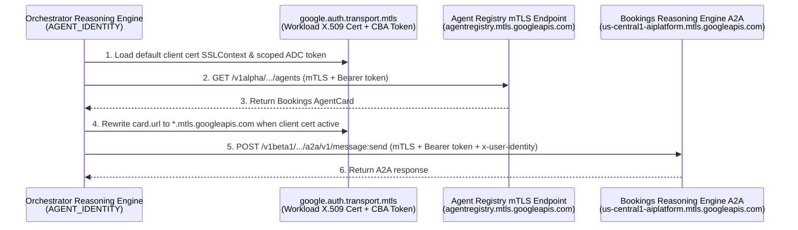

# Plan: Fix `401 UNAUTHENTICATED` When Discovering & Invoking Bookings Agent Under `AGENT_IDENTITY`

## 1. Problem Statement & Observed Error

When the deployed **Orchestrator Agent** (`projects/48196429354/locations/us-central1/reasoningEngines/1818476233864773632`) attempts to dynamically discover the **Bookings Agent** (`projects/48196429354/locations/us-central1/reasoningEngines/697851783812218880`) in Google Cloud Agent Registry (`agentregistry.googleapis.com`), the discovery call fails at runtime with `HTTP 401 Unauthorized`:

```text
INFO:orchestrator.security:Successfully validated IAP token. User email: securetoken.google.com/agent-security-patterns/ms-agent-tenant-tyd6t:yannipeng21@gmail.com
INFO:orchestrator.a2a_discovery:Successfully validated token in Orchestrator before A2A delegation.
INFO:httpx:HTTP Request: GET https://agentregistry.googleapis.com/v1alpha/projects/agent-security-patterns/locations/us-central1/agents "HTTP/1.1 401 Unauthorized"
ERROR:orchestrator.a2a_discovery:Failed to discover bookings agent in Agent Registry: API request failed with status 401: {
  "error": {
    "code": 401,
    "message": "Request had invalid authentication credentials. Expected OAuth 2 access token, login cookie or other valid authentication credential. See https://developers.google.com/identity/sign-in/web/devconsole-project.",
    "status": "UNAUTHENTICATED"
  }
}
```

---

## 2. Root Cause Analysis

### Root Cause 1: Certificate-Bound Access Tokens (mTLS / S2A) Under `IdentityType.AGENT_IDENTITY`
Both `orchestrator` and `bookings` are deployed on Vertex AI Agent Engine with:
```python
"identity_type": types.IdentityType.AGENT_IDENTITY
```
Under `IdentityType.AGENT_IDENTITY`:
1. The Reasoning Engine container is provisioned with a SPIFFE/X.509 workload client certificate (`principal://agents.global.org-419713829424.system.id.goog/resources/aiplatform/projects/48196429354/locations/us-central1/reasoningEngines/1818476233864773632`).
2. When `google.auth.default()` refreshes its credentials via the metadata server, the returned OAuth 2.0 access token is **certificate-bound** to that workload X.509 certificate.
3. **Google Cloud API mTLS Requirement:** Certificate-bound access tokens are **only** accepted when:
   - The TLS handshake presents the workload client certificate (`google.auth.transport.mtls.get_default_ssl_context()`), **and**
   - The request is sent to the **`*.mtls.googleapis.com`** endpoint (`https://agentregistry.mtls.googleapis.com/...` and `https://us-central1-aiplatform.mtls.googleapis.com/...`).
4. Why `Gemini` (`google-genai`) succeeded in the same container while `AgentRegistry` failed:
   - `google.genai._api_client` loads `mtls.get_default_ssl_context()` into its HTTP client and rewrites `*.googleapis.com` URLs to `*.mtls.googleapis.com` via `to_mtls_url()`.
   - By contrast, [`AgentRegistry`](file:///Users/yannipeng/git-projects/agent-security-patterns/.venv/lib/python3.12/site-packages/google/adk/integrations/agent_registry/agent_registry.py#L162-L247) (`google-adk==1.39.1`) hardcodes `AGENT_REGISTRY_BASE_URL = "https://agentregistry.googleapis.com/v1alpha"`, calls `google.auth.default()` without scopes, and uses a plain `httpx.Client()` with no client certificate and no `.mtls.googleapis.com` URL rewrite. When the certificate-bound Bearer token is presented over non-mTLS TLS to `agentregistry.googleapis.com`, Google Front End rejects it with `401 UNAUTHENTICATED`.

### Root Cause 2: Downstream A2A Data-Plane Calls (`RemoteA2aAgent` → `bookings`) Lack mTLS Configuration
In [orchestrator/a2a_discovery.py](file:///Users/yannipeng/git-projects/agent-security-patterns/orchestrator/a2a_discovery.py#L302-L305):
1. The `AgentCard` indexed in Agent Registry advertises the standard non-mTLS URL:
   `https://us-central1-aiplatform.googleapis.com/v1beta1/projects/48196429354/locations/us-central1/reasoningEngines/697851783812218880/a2a`
2. [`RegistryDiscoveredA2aAgent._run_async_impl`](file:///Users/yannipeng/git-projects/agent-security-patterns/orchestrator/a2a_discovery.py#L260-L328) constructs `httpx.AsyncClient(auth=GoogleADCAuth(), ...)` without passing the workload client certificate `SSLContext` (`verify=ssl_ctx`) and without rewriting the `*.googleapis.com` URL to `*.mtls.googleapis.com` when a client certificate is active.
3. Without mTLS support on the A2A `httpx.AsyncClient`, the A2A `POST /a2a/v1/message:send` request to `bookings` would hit the exact same `401 UNAUTHENTICATED` failure immediately after discovery succeeds.

### Root Cause 3: Missing `roles/agentregistry.viewer` IAM Binding on `ORCHESTRATOR_PRINCIPAL`
Inspection of project IAM bindings for `1818476233864773632` shows:
- Granted: `roles/aiplatform.user`, `roles/browser`, `roles/serviceusage.serviceUsageConsumer`, `roles/cloudtrace.agent`, `roles/logging.logWriter`, `roles/monitoring.metricWriter`, `roles/telemetry.tracesWriter`.
- **Missing:** `roles/agentregistry.viewer`.
Once mTLS resolves the `401 UNAUTHENTICATED` error, `agentregistry.mtls.googleapis.com` requires `roles/agentregistry.viewer` on `ORCHESTRATOR_PRINCIPAL` to authorize `agentregistry.agents.list` and `agentregistry.agents.get` (otherwise it will return `403 PERMISSION_DENIED`).

### Minor Diagnostic Issue: Logger Ordering in [orchestrator/agent.py](file:///Users/yannipeng/git-projects/agent-security-patterns/orchestrator/agent.py#L79-L110)
In [orchestrator/agent.py](file:///Users/yannipeng/git-projects/agent-security-patterns/orchestrator/agent.py#L79-L85), `logger.info(...)` is called inside a bare `try...except: pass` block at lines 81–83 before `logger = logging.getLogger(__name__)` is initialized at line 110, suppressing startup identity logs in Cloud Logging.

---

## 3. Architecture of the Fix



---

## 4. Implementation Checklist & Step-by-Step Plan

### Step 1: Add mTLS Helper Functions in [orchestrator/a2a_discovery.py](file:///Users/yannipeng/git-projects/agent-security-patterns/orchestrator/a2a_discovery.py)
- [x] **1.1** Import `ssl`, `urlparse`, `urlunparse` from standard library and `mtls` from `google.auth.transport`.
- [x] **1.2** Implement `_to_mtls_url(url: str) -> str` to rewrite `*.googleapis.com` to `*.mtls.googleapis.com` (and `*.sandbox.googleapis.com` to `*.mtls.sandbox.googleapis.com`) when not already targeting an `.mtls.` host.
- [x] **1.3** Implement `_get_mtls_ssl_context() -> Optional[ssl.SSLContext]` using `mtls.get_default_ssl_context()` and `mtls.should_use_mtls_endpoint(client_cert_available=True)` so it returns the client-certificate-enabled `ssl.SSLContext` inside `AGENT_IDENTITY` containers and `None` in standard non-mTLS environments.

```python
import ssl
from urllib.parse import urlparse, urlunparse
from google.auth.transport import mtls

def _to_mtls_url(url: str) -> str:
    """Rewrites a *.googleapis.com URL to its *.mtls.googleapis.com endpoint."""
    parsed = urlparse(url)
    netloc = parsed.netloc
    if netloc.endswith((".mtls.googleapis.com", ".mtls.sandbox.googleapis.com")):
        return url
    for domain in ("sandbox.googleapis.com", "googleapis.com"):
        if netloc.endswith("." + domain):
            netloc = netloc[: -len(domain)] + "mtls." + domain
            return urlunparse(parsed._replace(netloc=netloc))
    return url


def _get_mtls_ssl_context() -> Optional[ssl.SSLContext]:
    """Returns an SSLContext loaded with the default workload client certificate if active."""
    get_ctx_fn = getattr(mtls, "get_default_ssl_context", None)
    if get_ctx_fn is None:
        return None
    try:
        ctx = get_ctx_fn()
    except Exception as exc:
        logger.warning("Failed to load default mTLS SSL context from google-auth: %s", exc)
        return None
    if ctx is None:
        return None
    should_use_mtls = getattr(mtls, "should_use_mtls_endpoint", None)
    if should_use_mtls is not None:
        try:
            if not should_use_mtls(client_cert_available=True):
                return None
        except Exception as exc:
            logger.warning("Failed checking should_use_mtls_endpoint: %s", exc)
    return ctx
```

---

### Step 2: Subclass `AgentRegistry` for mTLS Discovery in [orchestrator/a2a_discovery.py](file:///Users/yannipeng/git-projects/agent-security-patterns/orchestrator/a2a_discovery.py)
- [x] **2.1** Create `MtlsAwareAgentRegistry(AgentRegistry)` in [orchestrator/a2a_discovery.py](file:///Users/yannipeng/git-projects/agent-security-patterns/orchestrator/a2a_discovery.py).
- [x] **2.2** In `MtlsAwareAgentRegistry.__init__`, acquire credentials with explicit cloud-platform scope: `self._credentials, _ = google.auth.default(scopes=["https://www.googleapis.com/auth/cloud-platform"])`.
- [x] **2.3** Override `MtlsAwareAgentRegistry._make_request(self, path: str, params: dict[str, Any] | None = None) -> dict[str, Any]` so that:
  - When `_get_mtls_ssl_context()` returns an `ssl.SSLContext`, it rewrites the request URL with `_to_mtls_url(url)` (`https://agentregistry.mtls.googleapis.com/v1alpha/...`) and executes `httpx.Client(verify=mtls_ssl_ctx, timeout=30.0)`.
  - When `_get_mtls_ssl_context()` returns `None`, it uses standard `httpx.Client(timeout=30.0)` against `https://agentregistry.googleapis.com/v1alpha/...`.
- [x] **2.4** Update [`resolve_bookings_agent_card_from_registry`](file:///Users/yannipeng/git-projects/agent-security-patterns/orchestrator/a2a_discovery.py#L97-L143) to instantiate `MtlsAwareAgentRegistry(project_id=project_id, location=location)` instead of the base `AgentRegistry`.

---

### Step 3: Enable mTLS on Downstream A2A Calls in [orchestrator/a2a_discovery.py](file:///Users/yannipeng/git-projects/agent-security-patterns/orchestrator/a2a_discovery.py)
- [x] **3.1** In [`GoogleADCAuth.auth_flow`](file:///Users/yannipeng/git-projects/agent-security-patterns/orchestrator/a2a_discovery.py#L60-L64), attach `x-goog-user-project` when `self._credentials.quota_project_id` is set, alongside `Authorization: Bearer <token>`.
- [x] **3.2** In [`RegistryDiscoveredA2aAgent._run_async_impl`](file:///Users/yannipeng/git-projects/agent-security-patterns/orchestrator/a2a_discovery.py#L260-L328):
  - Check `mtls_ssl_ctx = _get_mtls_ssl_context()`.
  - If `mtls_ssl_ctx` is present and `self._agent_card.url` points to `*.googleapis.com`, rewrite `self._agent_card.url = _to_mtls_url(self._agent_card.url)` (`https://us-central1-aiplatform.mtls.googleapis.com/v1beta1/.../a2a`).
  - Pass `verify=mtls_ssl_ctx if mtls_ssl_ctx is not None else True` to `httpx.AsyncClient(auth=GoogleADCAuth(), verify=..., timeout=...)`.

---

### Step 4: Fix Startup Logger Ordering in [orchestrator/agent.py](file:///Users/yannipeng/git-projects/agent-security-patterns/orchestrator/agent.py)
- [x] **4.1** Move `logger = logging.getLogger(__name__)` above line 75 in [orchestrator/agent.py](file:///Users/yannipeng/git-projects/agent-security-patterns/orchestrator/agent.py#L71-L110) so startup logs capture the resolved credential identity in Cloud Logging.

---

### Step 5: Grant `roles/agentregistry.viewer` IAM Permission
- [x] **5.1** Update [setup-scripts/after-agents-deployment-grant.sh](file:///Users/yannipeng/git-projects/agent-security-patterns/setup-scripts/after-agents-deployment-grant.sh) to include `roles/agentregistry.viewer` for `${ORCHESTRATOR_PRINCIPAL}`.
- [x] **5.2** Run `gcloud projects add-iam-policy-binding agent-security-patterns --member="${ORCHESTRATOR_PRINCIPAL}" --role="roles/agentregistry.viewer" --condition=None` so Reasoning Engine `1818476233864773632` is authorized to call `agentregistry.agents.list` and `agentregistry.agents.get`.

---

### Step 6: Unit Testing, Redeployment & Verification
- [x] **6.1** Add unit tests in [tests/test_a2a_discovery.py](file:///Users/yannipeng/git-projects/agent-security-patterns/tests/test_a2a_discovery.py) covering:
  - `_to_mtls_url()` URL transformations (`agentregistry.googleapis.com`, `us-central1-aiplatform.googleapis.com`, `localhost`, and idempotency on `*.mtls.googleapis.com`).
  - `MtlsAwareAgentRegistry._make_request()` with and without an active mTLS `SSLContext`.
  - `RegistryDiscoveredA2aAgent._run_async_impl()` rewriting `card.url` and passing `verify=mtls_ssl_ctx` to `httpx.AsyncClient` when mTLS is active.
- [x] **6.2** Run `uv run pytest tests/test_a2a_discovery.py` locally and confirm all unit tests pass.
- [x] **6.3** Redeploy `orchestrator` in-place via `uv run python orchestrator/deploy_agent_engine.py` (updating `projects/48196429354/locations/us-central1/reasoningEngines/1818476233864773632`).
- [x] **6.4** Verify end-to-end discovery and A2A invocation against the deployed `orchestrator` endpoint and confirm `200 OK` responses in Cloud Logging.
