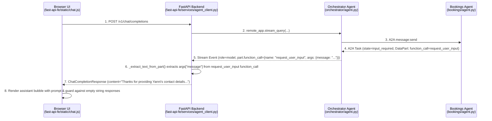

# Plan: Surface `request_user_input` Tool Prompts in the Chat UI

## 1. Problem Statement & Observed Behavior

When a user sends a booking request to the **Orchestrator Agent** ([`orchestrator/agent.py`](file:///Users/yannipeng/git-projects/agent-security-patterns/orchestrator/agent.py)) and the request is delegated via A2A to the **Bookings Agent** ([`bookings/agent.py`](file:///Users/yannipeng/git-projects/agent-security-patterns/bookings/agent.py)), missing booking details trigger the `request_user_input` tool:

```json
{
  "name": "request_user_input",
  "args": {
    "message": "Thanks for providing Yanni's contact details (yannipeng21@gmail.com). Could you please let me know the meeting subject/purpose, date, and start and end times?"
  }
}
```

Although this `request_user_input` function call is recorded in the orchestrator session events, the prompt inside `args.message` is never surfaced to the end user in the web UI ([`fast-api-fe/static/chat.js`](file:///Users/yannipeng/git-projects/agent-security-patterns/fast-api-fe/static/chat.js)), leaving an empty assistant message bubble and no indication of what information the agent is waiting for.

---

## 2. Root Cause Analysis

### Root Cause 1: `LongRunningFunctionTool` Ends the Agent Turn Without Emitting a `text` Part
1. Both [`orchestrator/agent.py`](file:///Users/yannipeng/git-projects/agent-security-patterns/orchestrator/agent.py#L112-L121) and [`bookings/agent.py`](file:///Users/yannipeng/git-projects/agent-security-patterns/bookings/agent.py#L295-L297) define [`request_user_input`](file:///Users/yannipeng/git-projects/agent-security-patterns/bookings/agent.py#L295-L297) and register it as `LongRunningFunctionTool(func=request_user_input)` ([`orchestrator/agent.py`](file:///Users/yannipeng/git-projects/agent-security-patterns/orchestrator/agent.py#L302), [`bookings/agent.py`](file:///Users/yannipeng/git-projects/agent-security-patterns/bookings/agent.py#L386)).
2. When the LLM calls `request_user_input(message="...")`, ADK populates `event.long_running_tool_ids` on the emitted event.
3. In [`Event.is_final_response`](file:///Users/yannipeng/git-projects/agent-security-patterns/.venv/lib/python3.12/site-packages/google/adk/events/event.py#L91), any event with non-empty `long_running_tool_ids` immediately evaluates to `True`, which causes [`BaseLlmFlow.run_async`](file:///Users/yannipeng/git-projects/agent-security-patterns/.venv/lib/python3.12/site-packages/google/adk/flows/llm_flows/base_llm_flow.py#L1018) to break out of the execution loop without running a subsequent LLM turn to generate a plain-text (`part.text`) response.
4. Across A2A (`bookings` $\rightarrow$ `orchestrator`), [`convert_event_to_a2a_events`](file:///Users/yannipeng/git-projects/agent-security-patterns/.venv/lib/python3.12/site-packages/google/adk/a2a/converters/event_converter.py#L509-L521) marks the A2A task as `TaskState.input_required` and serializes the `function_call` (`name: "request_user_input"`, `args: {"message": "..."}`) and its `function_response` (`{"status": "pending", "message": "..."}`) as A2A `DataPart`s in `task.status.message`.
5. When [`RemoteA2aAgent`](file:///Users/yannipeng/git-projects/agent-security-patterns/.venv/lib/python3.12/site-packages/google/adk/agents/remote_a2a_agent.py#L748-L750) in the orchestrator receives the A2A task, [`convert_a2a_task_to_event`](file:///Users/yannipeng/git-projects/agent-security-patterns/.venv/lib/python3.12/site-packages/google/adk/a2a/converters/event_converter.py#L317-L384) converts those `DataPart`s back into an ADK `Event` containing only `function_call` and `function_response` parts (with `long_running_tool_ids` set), which also terminates the orchestrator run without generating a `text` part.

### Root Cause 2: Backend Stream and Session History Consumers Ignore `function_call` Parts
1. In [`fast-api-fe/services/agent_client.py`](file:///Users/yannipeng/git-projects/agent-security-patterns/fast-api-fe/services/agent_client.py#L109-L131), [`_consume_response_stream`](file:///Users/yannipeng/git-projects/agent-security-patterns/fast-api-fe/services/agent_client.py#L109-L131) only extracts `part["text"]` (for dict events) or `part.text` (for object events). Because the `request_user_input` event only contains `function_call` and `function_response` parts, [`_consume_response_stream`](file:///Users/yannipeng/git-projects/agent-security-patterns/fast-api-fe/services/agent_client.py#L109-L131) returns an empty string `""`.
2. In [`get_session_history`](file:///Users/yannipeng/git-projects/agent-security-patterns/fast-api-fe/services/agent_client.py#L160-L196) (lines 186–192), `function_call` parts are also ignored (`text_parts = [p.text for p in event.content.parts if hasattr(p, "text") and p.text]`), so reloading or switching sessions in the sidebar drops `request_user_input` questions from the conversation history.

### Root Cause 3: Frontend Nullish Coalescing Operator (`??`) Allows Empty Strings
1. In [`fast-api-fe/static/chat.js`](file:///Users/yannipeng/git-projects/agent-security-patterns/fast-api-fe/static/chat.js#L154), [`fetchCompletion`](file:///Users/yannipeng/git-projects/agent-security-patterns/fast-api-fe/static/chat.js#L117-L155) returns:
   ```javascript
   return data.choices?.[0]?.message?.content ?? "No response from agent.";
   ```
2. Because `??` only falls back on `null` or `undefined`, the empty string `""` returned by the backend passes through unchanged and [`sendMessage`](file:///Users/yannipeng/git-projects/agent-security-patterns/fast-api-fe/static/chat.js#L160-L191) renders a blank assistant bubble.

---

## 3. Architecture of the Fix



---

## 4. Implementation Checklist & Step-by-Step Tasks

### Step 1: Add Part Text & `request_user_input` Extractor in [`fast-api-fe/services/agent_client.py`](file:///Users/yannipeng/git-projects/agent-security-patterns/fast-api-fe/services/agent_client.py)
- [x] **1.1** Implement a helper function `_extract_text_from_part(part) -> Optional[str]` in [`fast-api-fe/services/agent_client.py`](file:///Users/yannipeng/git-projects/agent-security-patterns/fast-api-fe/services/agent_client.py) that supports both `dict` parts (from `remote_app.stream_query`) and object/protobuf `Part` instances (from `SessionServiceAsyncClient.list_events`).
- [x] **1.2** In `_extract_text_from_part(part)`, return standard text when `part["text"]` or `part.text` is non-empty (skipping thought-only parts where `thought` is `True`).
- [x] **1.3** In `_extract_text_from_part(part)`, inspect `function_call` (and `functionCall` for camelCase dict payloads). When `name == "request_user_input"`, extract and return `args.get("message")` (handling both `dict` and protobuf `Struct` / mapping objects).

```python
def _extract_text_from_part(part) -> Optional[str]:
    """Extracts user-visible text from a content part, including request_user_input calls."""
    if isinstance(part, dict):
        if part.get("thought"):
            return None
        text = part.get("text")
        if text:
            return text
        fc = part.get("function_call") or part.get("functionCall")
        if isinstance(fc, dict) and fc.get("name") == "request_user_input":
            args = fc.get("args") or {}
            if isinstance(args, dict):
                msg = args.get("message")
                if msg:
                    return str(msg)
    else:
        if getattr(part, "thought", False):
            return None
        text = getattr(part, "text", None)
        if text:
            return text
        fc = getattr(part, "function_call", None)
        if fc and getattr(fc, "name", None) == "request_user_input":
            args = getattr(fc, "args", None)
            if args is not None and hasattr(args, "get"):
                msg = args.get("message")
                if msg:
                    return str(msg)
    return None
```

---

### Step 2: Update Stream Consumer in [`fast-api-fe/services/agent_client.py`](file:///Users/yannipeng/git-projects/agent-security-patterns/fast-api-fe/services/agent_client.py)
- [x] **2.1** Update [`_consume_response_stream`](file:///Users/yannipeng/git-projects/agent-security-patterns/fast-api-fe/services/agent_client.py#L109-L131) to call `_extract_text_from_part(part)` for each part in `content.get("parts", [])` (dict events) and `content.parts` (object events).
- [x] **2.2** Prevent duplicate message appends in [`_consume_response_stream`](file:///Users/yannipeng/git-projects/agent-security-patterns/fast-api-fe/services/agent_client.py#L109-L131) if the same prompt text is emitted in both a `text` part and a `request_user_input` `function_call` part within the same response stream.

---

### Step 3: Update Session History Loader in [`fast-api-fe/services/agent_client.py`](file:///Users/yannipeng/git-projects/agent-security-patterns/fast-api-fe/services/agent_client.py)
- [x] **3.1** Update [`get_session_history`](file:///Users/yannipeng/git-projects/agent-security-patterns/fast-api-fe/services/agent_client.py#L160-L196) (lines 186–192) to extract part text using `_extract_text_from_part(p)` instead of filtering exclusively on `hasattr(p, "text") and p.text`.
- [x] **3.2** Ensure events containing `request_user_input` function calls are returned in the session history list with `role: "model"` (which [`fast-api-fe/static/chat.js`](file:///Users/yannipeng/git-projects/agent-security-patterns/fast-api-fe/static/chat.js#L287) maps to `"assistant"` when rendering history bubbles).

---

### Step 4: Guard Against Empty Assistant Bubbles in [`fast-api-fe/static/chat.js`](file:///Users/yannipeng/git-projects/agent-security-patterns/fast-api-fe/static/chat.js)
- [x] **4.1** Update [`fetchCompletion`](file:///Users/yannipeng/git-projects/agent-security-patterns/fast-api-fe/static/chat.js#L154) in [`fast-api-fe/static/chat.js`](file:///Users/yannipeng/git-projects/agent-security-patterns/fast-api-fe/static/chat.js) so empty or whitespace-only strings fall back to `"No response from agent."`:
  ```javascript
  const content = data.choices?.[0]?.message?.content;
  return content && content.trim() ? content : "No response from agent.";
  ```

---

### Step 5: Add Unit Tests & Verify End-to-End Behavior
- [x] **5.1** Create unit tests in `tests/test_agent_client_stream.py` covering:
  - [`_consume_response_stream`](file:///Users/yannipeng/git-projects/agent-security-patterns/fast-api-fe/services/agent_client.py#L109-L131) with dict events containing `request_user_input` `function_call` and pending `function_response` parts (matching the A2A response structure from `bookings`).
  - [`_consume_response_stream`](file:///Users/yannipeng/git-projects/agent-security-patterns/fast-api-fe/services/agent_client.py#L109-L131) deduplication when both `text` and `request_user_input` parts carry the same message.
  - [`get_session_history`](file:///Users/yannipeng/git-projects/agent-security-patterns/fast-api-fe/services/agent_client.py#L160-L196) with object/protobuf events containing `request_user_input` `function_call` parts.
- [x] **5.2** Run `uv run pytest tests/test_agent_client_stream.py` and verify all tests pass.
- [ ] **5.3** Test the chat UI flow (`orchestrator` $\rightarrow$ `bookings` $\rightarrow$ `request_user_input`) and confirm the clarification question is displayed in the assistant chat bubble and persisted across session reloads.
