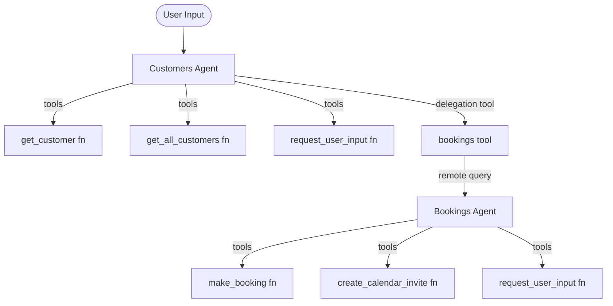
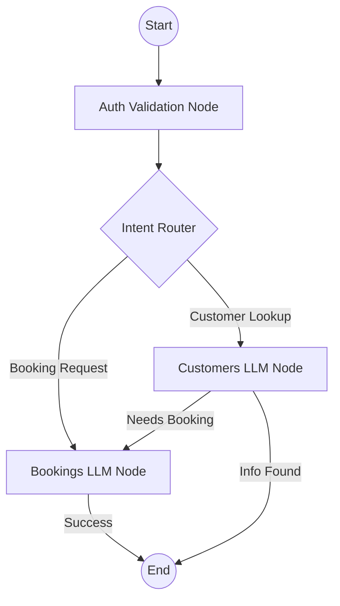

# ADK 1.x to 2.0 Migration Assessment Report

**Date:** 2026-05-19
**Codebase:** /Users/yannipeng/git-projects/agent-security-patterns
**Assessed by:** Antigravity (ADK Developer & migrate-adk skill)

---

## Executive Summary

| Metric | Value |
|--------|-------|
| Total agents discovered | 2 (Customers, Bookings) |
| LLM agents (LlmAgent) | 2 |
| Workflow agents (Sequential/Parallel/Loop) | 0 |
| Custom agents (BaseAgent subclasses) | 0 |
| Callbacks detected | 0 |
| Deterministic tools (migration candidates) | 4 |
| State keys in data flow | 3 (user_id, booking_details, user_timezone) |

**Overall Migration Score:** **STRONG**

**Recommendation:** Migrate to ADK 2.0 Workflow. The current hierarchical delegation via a custom tool (`bookings`) in the `Customers` agent is a prime candidate for a graph-based Workflow. Extracting customer lookup and user_id resolution into deterministic function nodes will reduce LLM round-trips, improve reliability, and lower latency.

---

## Current Architecture (ADK 1.x)



---

## Per-Agent Analysis

| Agent | Type | Pattern | Model | Tools | Callbacks | output_key | Migration Score | Rationale |
|-------|------|---------|-------|-------|-----------|------------|----------------|-----------|
| Customers | LlmAgent | P5a | Gemini 3.5 Flash | 4 | 0 | N/A | **STRONG** | Orchestrates delegation via a tool. Customer lookup is deterministic and can be a node. |
| Bookings | LlmAgent | P1b | Gemini 3.5 Flash | 3 | 0 | N/A | **STRONG** | Contains real-world API integration (Graph API) that benefits from structured execution. |

### Score Breakdown

**Customers Agent:**
  Base score: 2.0 (P5a - Single delegation)
  + Child is autonomous: +1.0
  + 2 deterministic tools: +1.0
  = Final: 4.0 -> **STRONG**

**Bookings Agent:**
  Base score: 3.0 (P1b - Tool-heavy)
  + 2 deterministic tools: +1.0
  = Final: 4.0 -> **STRONG**

---

## What Stays the Same

- **Instructions**: The core logic of how to handle bookings and customer data remains valid.
- **Models**: Both agents use `gemini-3-flash-preview`, which is preserved.
- **State keys**: `user_id`, `user_timezone`, and booking details will continue to be passed in the state.
- **Business logic**: The `create_calendar_invite` and `get_customer` functions are well-defined and will be moved to function nodes without logic changes.
- **Agent names**: `customers` and `bookings` will be preserved as node IDs for traceability.

---

## Migration Benefits

### Hierarchical Delegation Removal
- **Current**: The `Customers` agent calls the `bookings` tool, which spawns a new session and queries the `Bookings` agent. This involves double LLM reasoning for the same intent.
- **After migration**: Intent is routed directly to the `Bookings` node in the graph.
- **Benefit**: Reduced latency and token consumption.
- **Estimated savings**: ~1000 tokens per delegation and ~2-3 seconds of latency by avoiding a secondary LLM "thought" phase.

### Deterministic Customer Lookup
- **Current**: The LLM *decides* to call `get_customer`.
- **After migration**: A "Pre-processing" node can attempt to resolve `user_id` from context/database before even calling the LLM.
- **Benefit**: Improved reliability.

#### Key Change (before/after)

```python
# BEFORE (ADK 1.x) - customers/agent.py
def bookings(request: str, tool_context: ToolContext) -> str:
    remote_app = agent_engines.get(ENGINE_ID)
    remote_session = remote_app.create_session(user_id=user_id)
    response_stream = remote_app.stream_query(message=request, ...)
    return _consume_response_stream(response_stream)
```

```python
# AFTER (ADK 2.0) - workflow.py
@workflow.add_node
def route_request(state: State) -> Event:
    if "booking" in state.query.lower():
        return Event(goto="bookings")
    return Event(goto="customers")

workflow.add_edge("route_request", "bookings")
workflow.add_edge("route_request", "customers")
```

---

## Migration Risks & Known Production Issues

| Risk | Severity | Mitigation |
|------|----------|------------|
| Context Loss during Routing | MED | Ensure the `State` object captures all necessary metadata (tokens, timezone) before routing. |
| Tool Binding Errors | LOW | ADK 2.0 has stricter tool binding; verify type hints for all function nodes. |
| Multi-Worker `InMemoryTaskStore` A2A `404 Not Found` & Session Context Loss | HIGH | See [a2a-in-memory-task-store-404-bug.md](file:///Users/yannipeng/git-projects/agent-security-patterns/plans/migrate-to-adk2/a2a-in-memory-task-store-404-bug.md). Previously, `RemoteA2aAgent` truncated outgoing message history at the last `bookings` response and pinned requests to worker-local `task_id` (`InMemoryTaskStore`) and `context_id` (`InMemorySessionService`). When follow-up turns routed to a different uvicorn worker, they failed with HTTP `404 Not Found` (`TaskNotFoundError` `-32001`) or lost Turn 1 context in a blank in-memory session. Mitigated by removing `LongRunningFunctionTool(func=request_user_input)` from [`bookings/agent.py`](file:///Users/yannipeng/git-projects/agent-security-patterns/bookings/agent.py) and overriding history construction on [`RegistryDiscoveredA2aAgent`](file:///Users/yannipeng/git-projects/agent-security-patterns/orchestrator/a2a_discovery.py#L274-L492) to forward the full conversation transcript with `context_id=None` and `task_id=None`. Migrating to an ADK 2.0 graph workflow or shared state store eliminates per-worker state fragmentation altogether. |

---

## What ADK 2.0 Unlocks Next

- **Explicit Security Guardrails**: Add a security validation node *before* any agent node to check token validity deterministically.
- **Conditional Fan-out**: If a user asks for "bookings for all customers", the workflow can fan-out to query each customer in parallel.
- **HITL Verification**: Add a `RequestInput` node specifically for confirming calendar invites before they are sent.

---

## Proposed Architecture (ADK 2.0)



---

## Implementation Plan

### Phase 1: Setup
- [ ] Install ADK 2.0
- [ ] Create `migrate-to-adk2/workflow.py`
- [ ] Port helper functions (`get_secret`, `validate_token`) to a shared `utils.py`.

### Phase 2: Core Migration
- [ ] **Step 1**: Create the base Workflow graph.
- [ ] **Step 2**: Convert `get_customer` into a function node.
- [ ] **Step 3**: Define the `bookings` and `customers` LLM nodes.
- [ ] **Step 4**: Implement the routing logic to replace the delegation tool.

---

*Report generated by Antigravity. Assessment based on ADK 2.0 Workflow capabilities and pattern-specific migration mappings.*
