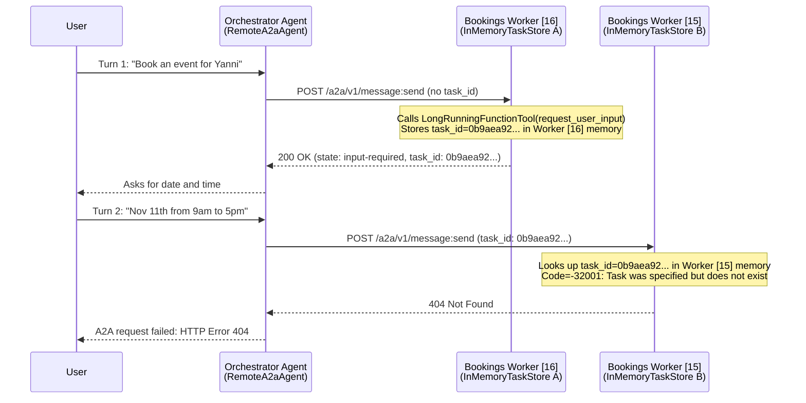

# Bug Report: Intermittent A2A `404 Not Found` Across Multi-Worker Reasoning Engine Instances

**Date:** 2026-10-27  
**Affected Components:**
- [`bookings/agent.py`](file:///Users/yannipeng/git-projects/agent-security-patterns/bookings/agent.py)
- [`bookings/app.py`](file:///Users/yannipeng/git-projects/agent-security-patterns/bookings/app.py)
- [`bookings/agent_executor.py`](file:///Users/yannipeng/git-projects/agent-security-patterns/bookings/agent_executor.py)
- [`orchestrator/a2a_discovery.py`](file:///Users/yannipeng/git-projects/agent-security-patterns/orchestrator/a2a_discovery.py)

---

## 1. Symptom & Observed Error

When prompting the Orchestrator Agent (`projects/803095609412/locations/us-central1/reasoningEngines/319283058421268480`) for bookings across multiple turns in the same session, delegation to the Bookings Agent (`projects/803095609412/locations/us-central1/reasoningEngines/7902218931006341120`) intermittently fails with an HTTP `404 Not Found` error on the A2A `message:send` endpoint:

```text
errorCode: undefined
errorMessage: "A2A request failed: HTTP Error 404: Client error '404 Not Found' for url 'https://us-central1-aiplatform.mtls.googleapis.com/v1beta1/projects/803095609412/locations/us-central1/reasoningEngines/7902218931006341120/a2a/v1/message:send'
For more information check: https://developer.mozilla.org/en-US/docs/Web/HTTP/Status/404"
```

---

## 2. Root Cause Analysis

The HTTP `404 Not Found` is **not** caused by a missing Vertex AI Reasoning Engine resource. Instead, it is returned by the **A2A REST server inside the Bookings Reasoning Engine** when a paused (`input-required`) A2A task is resumed on a different uvicorn worker process (or container replica) than the one that created it.

### Step-by-Step Failure Mechanism

1. **Turn 1 — Task Created in `input-required` State on Worker `[16]`:**
   - When the user's initial booking prompt is missing details (or requires confirmation), the Bookings agent previously called `LongRunningFunctionTool(func=request_user_input)`.
   - [`A2aAgentExecutor`](file:///Users/yannipeng/git-projects/agent-security-patterns/.venv/lib/python3.12/site-packages/google/adk/a2a/executor/a2a_agent_executor.py) converts a `LongRunningFunctionTool` event into an A2A task with state `input-required`.
   - Because [`a2a_app`](file:///Users/yannipeng/git-projects/agent-security-patterns/bookings/app.py#L12-L15) in [`bookings/app.py`](file:///Users/yannipeng/git-projects/agent-security-patterns/bookings/app.py) uses the default `task_store_builder` in [`A2aAgent.set_up()`](file:///Users/yannipeng/git-projects/agent-security-patterns/.venv/lib/python3.12/site-packages/vertexai/preview/reasoning_engines/templates/a2a.py#L266-L270), tasks are stored in a process-local `InMemoryTaskStore`.
   - Worker process **`[16]`** stores `task_id: 0b9aea92-6a5b-48dd-a993-81ddcc9a4c30` in its own process memory and returns `200 OK`.

2. **Turn 2 — Task Resumed on Worker `[15]`:**
   - When the user replies in the same session, [`RemoteA2aAgent`](file:///Users/yannipeng/git-projects/agent-security-patterns/.venv/lib/python3.12/site-packages/google/adk/a2a/agent/_remote_a2a_agent.py#L1291-L1308) in the Orchestrator sees that the previous Bookings task ended in `input-required` state and attaches `task_id = "0b9aea92-6a5b-48dd-a993-81ddcc9a4c30"` and `context_id = "4e6eafa9-d953-41d0-984b-1795684f96ca"` to the outgoing `message:send` request.
   - Vertex AI Agent Engine routes the incoming request to uvicorn worker process **`[15]`** (instead of `[16]`).
   - Worker **`[15]`** looks up `task_id: 0b9aea92-6a5b-48dd-a993-81ddcc9a4c30` in its own `InMemoryTaskStore`, fails to find it, and raises A2A JSON-RPC error `-32001` (`TaskNotFoundError`).
   - The A2A REST transport maps `TaskNotFoundError` (`-32001`) directly to **HTTP `404 Not Found`**.

### Cloud Logging Evidence (`projects/genai-apps-25`, Reasoning Engine `7902218931006341120`)

```text
# Turn 1 (2026-10-28T00:08:10Z - handled by worker [16])
INFO:a2a.server.tasks.task_manager:Task not found or task_id not set. Creating new task for event (task_id: 0b9aea92-6a5b-48dd-a993-81ddcc9a4c30, context_id: 4e6eafa9-d953-41d0-984b-1795684f96ca).
[16] INFO: 169.254.169.126:22806 - "POST /api/a2a/v1/message%3Asend HTTP/1.1" 200 OK

# Turn 2 (2026-10-28T00:09:13Z - routed to worker [15])
WARNING:a2a.utils.error_handlers:Request error: Code=-32001, Message='Task 0b9aea92-6a5b-48dd-a993-81ddcc9a4c30 was specified but does not exist'
[15] INFO: 169.254.169.126:59862 - "POST /api/a2a/v1/message%3Asend HTTP/1.1" 404 Not Found
```

### Sequence Diagram



---

## 3. Resolution Applied

To prevent the Bookings agent from leaving worker-bound tasks open in the `input-required` state and to prevent multi-worker session history loss:

1. **Removed `LongRunningFunctionTool(func=request_user_input)` from [`bookings/agent.py`](file:///Users/yannipeng/git-projects/agent-security-patterns/bookings/agent.py):**
   - Removed `request_user_input` and `LongRunningFunctionTool` from [`create_agent`](file:///Users/yannipeng/git-projects/agent-security-patterns/bookings/agent.py#L348-L380).
   - Updated the agent instructions so missing booking details are requested directly in the assistant's text response rather than pausing the A2A task via a tool call.
2. **Enabled Stateless Full-History Forwarding in [`orchestrator/a2a_discovery.py`](file:///Users/yannipeng/git-projects/agent-security-patterns/orchestrator/a2a_discovery.py):**
   - Enabled `full_history_when_stateless=True` by default on [`RegistryDiscoveredA2aAgent`](file:///Users/yannipeng/git-projects/agent-security-patterns/orchestrator/a2a_discovery.py#L274-L492).
   - Overrode [`_create_a2a_request_for_user_function_response`](file:///Users/yannipeng/git-projects/agent-security-patterns/orchestrator/a2a_discovery.py#L315-L321), [`_get_resumable_task_id`](file:///Users/yannipeng/git-projects/agent-security-patterns/orchestrator/a2a_discovery.py#L323-L329), and [`_construct_message_parts_from_session`](file:///Users/yannipeng/git-projects/agent-security-patterns/orchestrator/a2a_discovery.py#L331-L367) so prior `bookings` responses are formatted as conversation context and the complete session history is forwarded with `context_id=None` and `task_id=None` on every turn.
3. **Effect on A2A Task & Session Lifecycle:**
   - Every turn handled by [`A2aAgentExecutor`](file:///Users/yannipeng/git-projects/agent-security-patterns/.venv/lib/python3.12/site-packages/google/adk/a2a/executor/a2a_agent_executor.py#L283-L296) transitions to `completed` (`TASK_STATE_COMPLETED`) at the end of the response.
   - Subsequent turns never attach a prior worker's `task_id` or `context_id` and carry the full conversation transcript, allowing any uvicorn worker replica to handle any turn without `404 Not Found` errors or lost booking context.

---

## 4. Deep Dive: What Was Happening Prior vs. What Happens Now in [`orchestrator/a2a_discovery.py`](file:///Users/yannipeng/git-projects/agent-security-patterns/orchestrator/a2a_discovery.py)

### What Was Happening Prior

Previously, [`RemoteA2aAgent._construct_message_parts_from_session`](file:///Users/yannipeng/git-projects/agent-security-patterns/.venv/lib/python3.12/site-packages/google/adk/a2a/agent/_remote_a2a_agent.py#L1372-L1432) assumed the remote A2A server had a **stateful, shared session store** keyed by `context_id` and `task_id`.

When [`RemoteA2aAgent`](file:///Users/yannipeng/git-projects/agent-security-patterns/.venv/lib/python3.12/site-packages/google/adk/a2a/agent/_remote_a2a_agent.py#L469-L1440) built an outgoing A2A request, it walked **backward** through `ctx.session.events` and stopped as soon as it encountered the previous response from `bookings`:

```python
# Default behavior inside google.adk.a2a.agent._remote_a2a_agent.py (lines 1387-1402):
for event in reversed(ctx.session.events):
  if self._is_remote_response(event):
    context_id = (
        event.custom_metadata.get(A2A_METADATA_PREFIX + "context_id")
        if event.custom_metadata
        else None
    )
    if not self._full_history_when_stateless or context_id:
      break
  events_to_present.append(event)
```

Note the condition `if not self._full_history_when_stateless or context_id: break`. Because [`A2aAgentExecutor`](file:///Users/yannipeng/git-projects/agent-security-patterns/.venv/lib/python3.12/site-packages/google/adk/a2a/executor/a2a_agent_executor.py) always returns a `context_id` in the Turn 1 response metadata (`a2a:context_id`), `context_id` is always truthy on Turn 2—even if `full_history_when_stateless=True` is passed to `RemoteA2aAgent`.

#### Prior Turn-by-Turn Payload Behavior

1. **Turn 1 (`"Book an event for Yanni"`):**
   - There are no prior `bookings` events in `ctx.session.events`.
   - `RemoteA2aAgent` sends:
     - `parts`: `["Book an event for Yanni", "For context: [orchestrator] called tool transfer_to_agent..."]`
     - `context_id`: `None`
     - `task_id`: `None`
   - Bookings **Worker `[16]`** receives this, creates a new session `context_id = "4e6eafa9..."` in Worker `[16]`'s local `InMemorySessionService` and `task_id = "0b9aea92..."` in Worker `[16]`'s local `InMemoryTaskStore`, and replies: *"What date and time would you like to book for Yanni?"*
   - The Orchestrator saves that reply in its session history with `custom_metadata = {"a2a:context_id": "4e6eafa9...", "a2a:task_id": "0b9aea92...", "a2a:task_state": "input-required"}`.

2. **Turn 2 (`"Nov 11th from 9am to 5pm"`):**
   - `RemoteA2aAgent` walks backward through `ctx.session.events`:
     - Sees the Turn 2 event: `"Nov 11th from 9am to 5pm"`.
     - Hits the Turn 1 `bookings` response (`self._is_remote_response(event) == True`), extracts `context_id = "4e6eafa9..."`, and **immediately breaks out of the loop** (`break`).
   - As a result, `RemoteA2aAgent` **only sends the Turn 2 delta** in the A2A message:
     - `parts`: `["Nov 11th from 9am to 5pm"]` *(Turn 1 is completely omitted)*
     - `context_id`: `"4e6eafa9..."`
     - `task_id`: `"0b9aea92..."`
   - When Vertex AI Agent Engine routes Turn 2 to **Worker `[15]`**:
     - **Failure Mode A (`task_id` set):** Worker `[15]` looks up `task_id = "0b9aea92..."` in its own `InMemoryTaskStore`, fails to find it, and returns **`404 Not Found`** (`TaskNotFoundError` `-32001`).
     - **Failure Mode B (`task_id=None`, `context_id` set):** Even after removing `LongRunningFunctionTool`, Worker `[15]` looks up `context_id = "4e6eafa9..."` in its own `InMemorySessionService`, doesn't find it, creates a brand-new empty session, and only sees `"Nov 11th from 9am to 5pm"`—having no idea *who* the booking is for or *what* was discussed in Turn 1.

---

### What Happens Now

With the overrides in [`RegistryDiscoveredA2aAgent`](file:///Users/yannipeng/git-projects/agent-security-patterns/orchestrator/a2a_discovery.py#L274-L492), the Orchestrator's `ctx.session.events` acts as the **single source of truth** for the conversation history, and each A2A call to `bookings` is self-contained and worker-agnostic:

1. **Prior `bookings` responses are converted into conversation context instead of stopping the loop:**
   - In [`_construct_message_parts_from_session`](file:///Users/yannipeng/git-projects/agent-security-patterns/orchestrator/a2a_discovery.py#L331-L367), any prior event authored by `bookings` (`self._is_remote_response(event)`) is formatted using ADK's [`_present_other_agent_message`](file:///Users/yannipeng/git-projects/agent-security-patterns/.venv/lib/python3.12/site-packages/google/adk/flows/llm_flows/context/_fencing.py#L43-L79), which turns the event into:
     ```text
     For context:
     [bookings] said: What date and time would you like to book for Yanni?
     ```
2. **Worker-local `a2a:context_id` and `a2a:task_id` metadata are stripped:**
   - [`_construct_message_parts_from_session`](file:///Users/yannipeng/git-projects/agent-security-patterns/orchestrator/a2a_discovery.py#L331-L367) returns `(message_parts, None)` (`context_id = None`), and [`_get_resumable_task_id`](file:///Users/yannipeng/git-projects/agent-security-patterns/orchestrator/a2a_discovery.py#L323-L329) returns `None` (`task_id = None`).
3. **Turn 2+ sends the complete conversation transcript in `parts`:**
   - On Turn 2 (`"Nov 11th from 9am to 5pm"`), `RegistryDiscoveredA2aAgent` sends:
     - `parts`:
       1. `"Book an event for Yanni"` (Turn 1 user prompt)
       2. `"For context: [orchestrator] called tool transfer_to_agent with parameters: {'agent_name': 'bookings'}"`
       3. `"For context: [bookings] said: What date and time would you like to book for Yanni?"` (Turn 1 bookings reply)
       4. `"Nov 11th from 9am to 5pm"` (Turn 2 user reply)
     - `context_id`: `None`
     - `task_id`: `None`

#### Comparison Summary

| Aspect | Prior (`RemoteA2aAgent` Default) | Now (`RegistryDiscoveredA2aAgent` Stateless Full History) |
| :--- | :--- | :--- |
| **Turn 2+ `parts` sent to Bookings** | Only the latest message since the last `bookings` reply (`["Nov 11th from 9am to 5pm"]`) | Full session history (`Turn 1 user` + `orchestrator transfer` + `[bookings] said: ...` + `Turn 2 user`) |
| **Outgoing `task_id`** | Pinned to Turn 1 worker's `InMemoryTaskStore` UUID | Always `None` |
| **Outgoing `context_id`** | Pinned to Turn 1 worker's `InMemorySessionService` UUID | Always `None` |
| **When Turn 2 hits a different worker** | `404 Not Found` (`TaskNotFoundError`) or amnesia (empty session missing Turn 1) | Succeeds on any worker with full context of all prior turns |

---

## 5. Architectural Implications for ADK 2.0 Migration

Even without `input-required` task states, [`AdkAgentToA2AExecutor`](file:///Users/yannipeng/git-projects/agent-security-patterns/bookings/agent_executor.py#L9-L21) still initializes `Runner` with `InMemorySessionService()`, which is also per-worker:
- If Turn 1 lands on Worker `[16]` and Turn 2 lands on Worker `[15]` with the same `context_id`, Worker `[15]` creates a new empty session in memory and does not have Turn 1's conversation history unless the caller forwards full history (`full_history_when_stateless=True` with stateless history construction) or shares a persistent `SessionService` (such as `VertexAiSessionService`).
- Consolidating into an ADK 2.0 Graph Workflow (or backing A2A agents with shared session/task storage) eliminates per-worker in-memory state drift across multi-turn conversations.
