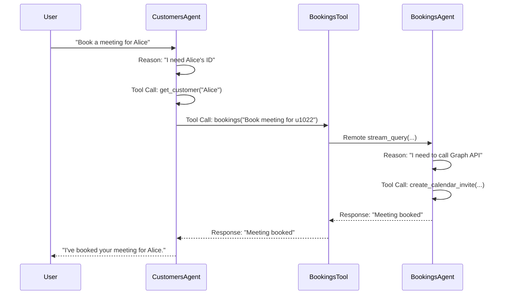
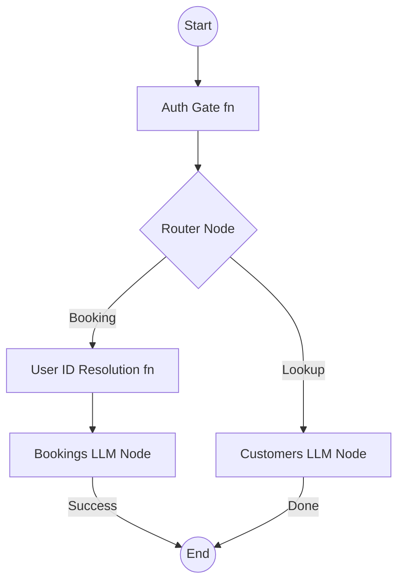

# Architecture Comparison: ADK 1.x vs ADK 2.0

This document visualizes the structural changes during the migration to ADK 2.0 Workflows.

## ADK 1.x: Hierarchical Delegation (Current)

In the current setup, the `Customers` agent acts as a "manager" that uses a custom tool to talk to the `Bookings` agent. This creates a nested reasoning loop.

## ADK 2.0: Graph-based Workflow (Proposed)

In ADK 2.0, the "management" is handled by the graph structure. Routing is explicit, and deterministic tasks are handled by function nodes, saving LLM time.

### Key Differences

| Feature | ADK 1.x | ADK 2.0 |
|---------|---------|---------|
| **Orchestration** | Implicit (via tools/callbacks) | Explicit (via Graph edges) |
| **Delegation** | Heavy (Remote SDK calls) | Lightweight (Node transitions) |
| **State** | Hidden / Local | Shared `State` object |
| **Logic** | Mostly LLM-driven | Mixed (Function + LLM nodes) |
| **Debugging** | Hard (nested traces) | Easy (Visual graph flow) |
| **Latency** | High (multiple LLM calls) | Low (deterministic pre-processing) |
